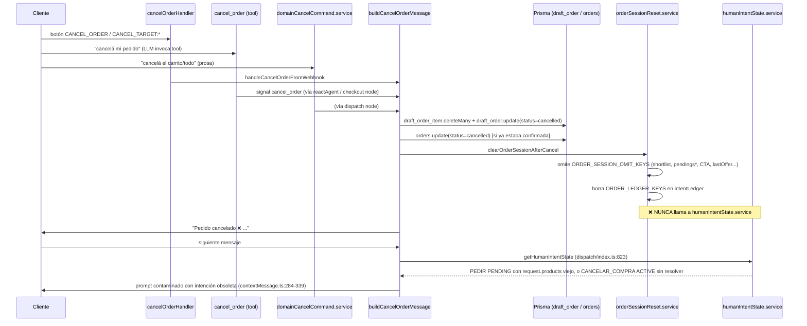

# Auditoría: ciclo de vida y contaminación de estado operativo conversacional

**Estado: diagnóstico. No se modificó código ni datos en esta auditoría.**

Origen: al investigar que `resetE2eCustomer` reutilizaba la conversación de interacciones reales
de WhatsApp, surgió la pregunta más amplia de si la cancelación de un pedido real invalida
correctamente todo el estado operativo que se fue acumulando en Gesty. Este documento cubre el
ciclo de vida completo: creación de pedido → finalización / cancelación / abandono → inicio de un
pedido nuevo.

---

## 0. Hallazgo principal (resumen ejecutivo)

**Cancelar un pedido o carrito completo (`cancel_order`, botones `CANCEL_ORDER` /
`CANCEL_TARGET:*`) nunca limpia `conversation_state.metadata.humanIntentState`.**

Las tres rutas de entrada de cancelación (botón de WhatsApp, tool `cancel_order` del agente,
comando de dominio en prosa) convergen todas en `buildCancelOrderMessage`
([order.service.ts:220-326](../../src/services/order.service.ts)), que sí borra correctamente el
carrito/draft/orden en DB y limpia una lista grande de claves de metadata
(`ORDER_SESSION_OMIT_KEYS`, `ORDER_LEDGER_KEYS` en `orderSessionReset.service.ts`), pero **nunca
toca `humanIntentState`**. Un `HumanIntentRecord` con `goal: 'CANCELAR_COMPRA'` (ACTIVE) o un
`PEDIR` que quedó `PENDING` con `request.products` de productos ya borrados del draft, sigue vivo
indefinidamente y se **reinyecta literalmente en el prompt del agente** en el turno siguiente
(`contextMessage.ts:284-339`).

Esto es asimétrico respecto a cancelar **una línea** (`cancel_order_line`), que sí reconcilia
`humanIntentState` vía `closeAbandonedPedirIntent` cuando el abandono queda completo — porque ese
flujo pasa por `PostEffectToolNode`, y el de cancelación total no.

Por separado: la sospecha inicial sobre `resetE2eCustomer` **ya estaba corregida en el propio
repo** (commit `45c257d`, 2026-10-12): el omit-list del harness sí incluye `humanIntentState` y
existe un test de regresión dedicado (`e2e/reset-e2e-customer-isolation.e2e.test.ts`). El bug real
y vigente no está en el harness E2E — está en la ruta de cancelación de producción, y por
extensión puede afectar a **cualquier cliente real** cuya conversación quede "abierta" y se
reutilice en una interacción posterior (ver Fase 4.F).

---

## Fase 1 — Ruta completa de cancelación real

### 1.1 Tres entradas, un solo núcleo



Archivos clave:
- Webhook: `src/controllers/webhook/handlers/cancelOrderHandler.ts:7-22`
- Tool (solo señal UI, no muta nada): `src/tools/index.ts:3993-4013`
- Comando de dominio en prosa: `src/services/domainCancelCommand.service.ts`
- Núcleo real: `src/services/order.service.ts:220-326` (`buildCancelOrderMessage`),
  `:134-148` (`cancelActiveDraft`), `:150-174` (`cancelPlacedOrderAndNotifyAdmin`)
- Wipe de sesión: `src/services/orderSessionReset.service.ts:111-173`
  (`wipeOrderDomainState` / `clearOrderSessionAfterCancel`)
- Diseño deliberado de que solo la señal estructurada dispara el wipe (no el texto libre de
  handback): `src/services/checkout/cancelOrderHandback.ts:7-14`

### 1.2 Cancelar línea vs. cancelar pedido completo — SÍ son asimétricos

| | `cancel_order_line` (una línea) | `cancel_order` (pedido/carrito completo) |
|---|---|---|
| Efecto en draft | borra ese `draft_order_item` | `deleteMany` de todas las líneas + draft → `cancelled` |
| Pasa por `PostEffectToolNode` | **Sí** (`postEffectToolNode.ts:53-136`) | **No** — señal UI resuelta directo en nodos del grafo |
| Reconcilia `humanIntentState` | **Sí**, si el abandono queda total: `closeAbandonedPedirIntent` (`humanIntentReconciliation.service.ts:132-170`) | **No**, nunca |
| `pendingOrderLines` | la línea pasa a `cancelled`; si todas quedan cerradas, se marca `closedAt` (no se borra la clave) | la clave se **omite por completo** (`ORDER_SESSION_OMIT_KEYS`) — no queda `closedAt` |

Esta última fila es relevante para la Fase 3: el guard `closedAt` existe específicamente para que
`ensurePendingOrderLinesFromRequest` no reconstruya una cola ya cerrada — pero la ruta de
cancelación total borra la clave entera en vez de cerrarla, así que ese guard no se activa ahí.

---

## Fase 2 — Inventario de estado operativo

Toda esta sección vive en la columna `conversation_state.metadata` (JSON), salvo donde se indica
persistencia relacional propia. El mecanismo de escritura segura es `mutateConversationMetadata` /
`patchConversationMetadata` / `omitConversationMetadataKeys`
(`src/repositories/conversationState.repository.ts`), con una excepción notable: cualquier
escritura re-inyecta automáticamente las `productResolutions` en estado `consumed`
(`preserveConsumedProductResolutions`, líneas 12-41) para que nunca se pisen por accidente.

| Estado | Dónde se crea | Dónde se muta | Dónde se persiste | Dónde se rehidrata | Qué lo invalida | ¿Sobrevive a `cancel_order`? | Entidad |
|---|---|---|---|---|---|---|---|
| `humanIntentState` | `EMPTY_STATE()` al no existir (`humanIntentState.service.ts:99-105`) | `mutateState` + funciones públicas (`createHumanIntent`, `activateHumanIntent`, `cancelHumanIntent`, etc., líneas 579-765), bajo advisory lock | `conversation_state.metadata.humanIntentState` (jsonb_set puntual) | `getHumanIntentState` en cada turno (`dispatch/index.ts:823`) + `buildHumanIntentContextLines` en el prompt (`contextMessage.ts:284-339`) | records pasan a estado terminal (RESOLVED/CANCELLED/REPLACED) vía las funciones de arriba — **nadie las invoca desde la cancelación total** | **SÍ** ⚠️ (bug) | Conversación |
| `pendingOrderLines` | tool `plan_order_lines` o `ensurePendingOrderLinesFromRequest` (deriva de `humanIntentState` si falta) | `activateNextOrderLine`, `cancelOrderLine`, `setOrderLineRequestedQuantity`, etc. | `metadata.pendingOrderLines` | `getPendingOrderLines` + líneas de contexto | `clearPendingOrderLines` (borra) o `closedAt` (cierra sin borrar) | No (se omite por completo) | Conversación (contenedor) / Línea de pedido (cada `OrderLine`) |
| `pendingVariation` | al fallar `add_cart_item` por variación | servicio dedicado | metadata | `requirementEvaluator`, gate de `add_cart_item` | `clearPendingVariation` | No | Conversación |
| `pendingAddQuantity` | sugerencia de cantidad por party size | `setPendingAddQuantity` | metadata | gate exclusivo en `add_cart_item` | `clearPendingAddQuantity` / tool `clear_pending_add_quantity` | No | Conversación (atado a 1 `productId`) |
| `pendingItemNote` | tool `start_item_note` | tool `update_item_note` (consume y escribe en `draft_order_item.notes`) | metadata | bloquea otras tools mientras esté activo (prompt + `contextMessage.ts:708-724`) | tool `clear_pending_item_note` | No | Conversación o Línea de pedido |
| `pendingAction` (⚠️ **3 máquinas de estado distintas bajo el mismo nombre**, sin namespacing: carrito `CONFIRM_REMOVE`/`EDIT_CART`, checkout `payment_method`/`fulfillment_type`/`confirm_order`, wizards de reserva/onboarding) | cada subsistema por separado | cada subsistema | metadata | cada subsistema lee su propio string esperado | cada subsistema limpia el suyo; carrito también vía `orderSessionReset` | Parcial (solo la variante de carrito está en el omit-list confirmado) | Línea de pedido / Conversación según variante |
| `lastCtaPayload` / `lastCtaProductId` / `lastCtaShownAt` | al mostrar un CTA híbrido (`reactAgent.ts:1367-1371`) | mismo sitio | metadata | correlación de click en `dispatch/index.ts:592,994` | solo por el wipe completo de dominio (`orderSessionReset.service.ts:56-58`) | No | Conversación (atado a 1 producto) |
| `lastOffer` | `persistLastOffer` (también emite un `ProductResolution`) | mismo servicio | **Ledger `intentLedger.CONFIRMAR_OFERTA`** (canal primario) + clave legacy `lastOffer` como fallback de lectura | `getLastOffer`, prioriza Ledger | `clearLastOffer` / tool `clear_last_offer` | No (está en `orderSessionReset`) | Conversación |
| `productResolutions` (array, cap 200) | `issueProductResolutions` | ciclo `candidate→resolved→selected→consumed` | `metadata.productResolutions`, protegido contra pisado (`preserveConsumedProductResolutions`) | `validateTaskResolutionOwnership` (exclusividad 1 resolución ↔ 1 línea) | nunca se borra, solo se marca `consumed` o se expulsa por el cap de 200 | **SÍ** ⚠️ (no está en `ORDER_SESSION_OMIT_KEYS`) | Conversación (array) / Línea de pedido (cuando `taskBound`) |
| `intentLedger` (Facts/Goals/Opportunities — ADR-0007/0008/0009) | derivadores puros (`activeIntent.service.ts`, `opportunities.service.ts`, etc.) | `patchIntentLedgerEntry` (merge por tipo) | `metadata.intentLedger` | ranking de 1 solo Intent activo por turno (`activeIndex.service.ts`) | `ORDER_LEDGER_KEYS` borra solo las entradas de dominio pedido; **reserva se preserva a propósito** | Parcial (las de pedido sí se limpian) | Conversación |
| Carrito / `draft_order` / `draft_order_item` | tabla Prisma propia | `cart.service.ts` | tablas relacionales (`prisma/schema.prisma:219-254`) | lectura directa de DB | cancelación / expiración por `expires_at` | Se borra (ese es el único punto que sí funciona bien) | Pedido / Línea de pedido |
| `queueFollowUp` | **no existe con ese nombre** | — | — | equivalente real: Goals reanudables del Ledger (`COMPLETAR_PEDIDO`, etc.) + `buildResumeFollowUp` (función de renderizado, no de estado) | — | — | — |

Otros estados de menor criticidad relevados pero ya correctamente gobernados (confirmados en
`ORDER_SESSION_OMIT_KEYS`): `pendingProductSelection`, `pendingQuestion`, `candidateProductIds`,
`shortlistAwaitingChoice`, `pendingComplementSelection`, `pendingTipables`, `pending_address_*`,
`pending_fulfillment_action`, `pending_cancel_disambiguation`, `pending_closed_add_item`,
`pending_switch_to_reservation`. Explícitamente **no tocados a propósito** por ser de otro
dominio: `reservation_draft`, `onboarding_step`, `ambassador_ref` (se autoconsume al crear la
orden). Estados ya eliminados en migraciones previas (V-09/V-10/V-11), documentados solo para que
nadie los reintroduzca: `awaitingPeopleCount`, `awaitingIntentConfirmation`,
`name_refusal_count`/`address_refusal_count`.

---

## Fase 3 — ¿La cancelación es coherente?

| Pregunta | Resultado | Evidencia |
|---|---|---|
| ¿`humanIntentState.active` queda invalidado tras cancelar el pedido completo? | **No** | Ningún caller de `buildCancelOrderMessage` llama a `cancelHumanIntent`/`resolveActiveHumanIntent`; grep de `CANCELAR_COMPRA` fuera del propio servicio no encontró ningún consumidor |
| ¿Un intent `PENDING` puede reactivarse accidentalmente? | **Estructuralmente sí** (confirmado el mecanismo, no garantizado que siempre ocurra) | `applyHumanIntentTurnDecision` tiene una rama `RESUME_PENDING`; si el preflight del turno siguiente clasifica el mensaje del cliente como continuación en vez de intención nueva, reactiva el `PEDIR` viejo con su `request.products` obsoleto |
| ¿`request.products` puede materializar de nuevo vía `ensurePendingOrderLinesFromRequest`? | **Sí, causalmente demostrado** | El guard `closedAt` que existe justo para evitar esto solo se activa cuando `pendingOrderLines` se cierra "normalmente" (todas las líneas a `done`/`cancelled`); la cancelación total usa `omitConversationMetadataKeys`, que **borra la clave entera** en vez de cerrarla. Si `humanIntentState` conserva `request.products` (confirmado arriba que sobrevive), y en el turno siguiente se re-deriva la cola porque no hay `pendingOrderLines`, el guard no tiene nada que comparar: puede reconstruir la cola desde productos que ya fueron cancelados |
| ¿Pueden reaparecer líneas canceladas? | Plausible, vía el mecanismo anterior | mismo razonamiento |
| ¿Una resolución de producto antigua puede autorizar una mutación nueva? | **No verificado directamente — riesgo abierto, no confirmado** | `productResolutions` sobrevive al cancelar (no está en el omit-list), pero `validateTaskResolutionOwnership` exige una Task `active`/`queued` con `currentResolutionId` igual — como `pendingOrderLines` se borró, no hay Task viva para bindear de inmediato. El riesgo aparece **solo si** la cola se reconstruye por el mecanismo anterior; requiere una prueba dedicada antes de afirmar que es explotable |
| ¿Cantidad/variación/nota anterior puede asociarse a otro producto? | **No, esto está limpio** | `pendingVariation`, `pendingAddQuantity`, `pendingItemNote` están todos en `ORDER_SESSION_OMIT_KEYS` |
| ¿Una CTA o continuación anterior puede ejecutar una acción en el siguiente turno? | **No, esto está limpio** | `lastCtaPayload`/`lastCtaProductId`/`lastCtaShownAt` y `lastOffer` sí están cubiertos por el wipe completo de dominio |
| ¿El ranker legacy y HumanIntent discrepan sobre qué acción está activa? | No se encontró discrepancia adicional | Ambas rutas legacy (`reactAgent.ts`) y nueva (`graph/nodes/checkout`) llaman al mismo `buildCancelOrderMessage`, así que el gap de `humanIntentState` las afecta por igual, no es una discrepancia entre ellas |
| ¿El contexto incluye estado operativo obsoleto aunque la metadata principal parezca limpia? | **Sí, confirmado** | `contextMessage.ts:284-339` inyecta el `PEDIR`/`CANCELAR_COMPRA` obsoleto en el prompt aunque `ORDER_SESSION_OMIT_KEYS`/`ORDER_LEDGER_KEYS` ya se vean limpios |

**Conclusión de Fase 3:** el estado operativo obsoleto que sobrevive (`humanIntentState`,
`productResolutions`) **sí puede condicionar indebidamente una acción posterior** — no es mera
persistencia inocua. El canal de impacto demostrado es: `humanIntentState` obsoleto → prompt del
agente contaminado → posible `RESUME_PENDING` → `ensurePendingOrderLinesFromRequest` reconstruye
líneas desde datos viejos (el guard `closedAt` no aplica porque la clave fue borrada, no cerrada).

---

## Fase 4 — Contratos de ciclo de vida

### A. Cancelar una línea del pedido
- **Ya correcto.** Borra el `draft_order_item`; marca la `OrderLine` como `cancelled` en
  `pendingOrderLines`; si el abandono queda total, cierra el `PEDIR` vía
  `closeAbandonedPedirIntent`.
- Alcance esperado: solo esa línea y, si corresponde, el cierre del intent — nunca el resto del
  carrito ni intents no relacionados (reserva, dirección, etc.).

### B. Cancelar el pedido completo
- **Efectos actuales correctos:** borrado de líneas/draft en DB, `ORDER_SESSION_OMIT_KEYS`,
  `ORDER_LEDGER_KEYS` (dominio pedido), `mode=GLOBAL`, `current_intent=null`.
- **Falta (el bug):** resolver/cancelar en `humanIntentState` cualquier record `ACTIVE`/`PENDING`
  de dominio pedido (`CANCELAR_COMPRA`, `PEDIR`) ligado a esta conversación, usando las funciones
  ya existentes y seguras (`cancelHumanIntent`/`resolveActiveHumanIntent`), no un borrado crudo de
  metadata.
- **Falta (riesgo secundario, no confirmado como explotable):** invalidar/expirar las
  `productResolutions` de dominio pedido asociadas a ese draft, en vez de dejarlas vivas hasta el
  cap de 200.

### C. Abandonar un pedido incompleto (expiración de `draft_order.expires_at`)
- Dispara la misma `clearOrderSessionAfterCancel` que el cancel explícito → **mismo gap**, mismo
  fix aplica.

### D. Completar un pedido e iniciar otro posteriormente
- No se identificó un bug activo en esta ruta (no fue el foco de la investigación de código, y no
  se encontraron indicios de que el intent `PEDIR` completado no se resuelva). `ambassador_ref` se
  autoconsume correctamente al crear la orden. Recomendación: verificar con un test dedicado que el
  `PEDIR` que terminó en checkout exitoso efectivamente queda `RESOLVED`, no solo abandonado por
  sobreescritura del siguiente `NEW_INTENT` — no se puede afirmar que esto esté roto sin ese test,
  pero tampoco se puede dar por sentado que esté bien solo porque no se vio evidencia de lo
  contrario.

### E. Reiniciar una conversación para pruebas (`resetE2eCustomer`)
- **Ya corregido** (commit `45c257d`, 2026-10-12): omite `humanIntentState` explícitamente, con
  test de regresión dedicado. Es un reset "quirúrgico" (omit puntual), no un reemplazo total de
  metadata — correcto para su propósito.
- Pendiente real: **no es un problema de qué borra, sino de contra qué conversación corre** (ver
  Fase 5).

### F. Iniciar una conversación realmente nueva para un cliente existente
- **Punto ciego compartido con el bug de B.** `createOrGetOpenConversation` (la misma función que
  usa el webhook real) busca una conversación **abierta** existente para el par
  negocio+cliente, no crea necesariamente una fila nueva. Si la conversación anterior de ese
  cliente real quedó "abierta" con un `humanIntentState` obsoleto (p. ej. porque canceló un pedido
  hace semanas y el bug de B no lo limpió), un cliente real que vuelve a escribir puede heredar esa
  intención vieja de la misma forma que se demostró en la Fase 3 — **el bug de B no es solo
  teórico para E2E, es un riesgo de producción para cualquier cliente recurrente.**

---

## Fase 5 — Separación E2E / producción

- La única garantía de que el harness E2E no toque la base real es **`NODE_ENV`**:
  `isE2eEnabled()` exige `E2E_RUN=1` y `!isProductionEnv()` (`e2e/helpers/env.ts:23-31`), y
  `loadEnv()` (la misma función que usa la app en producción) carga `.env.production` solo si
  `NODE_ENV==='production'`.
- **No hay ninguna verificación a nivel de código** que compare `DATABASE_URL` contra una
  whitelist, ni un flag de "negocio de test" en el modelo `business`, ni un chequeo de que
  `PHONE_NUMBER_ID`/el teléfono de cliente de prueba sean dedicados. La separación depende
  enteramente de qué archivo `.env*` esté cargado en la máquina/entorno donde se ejecute.
- `E2E_PHONE_NUMBER_ID` = el mismo `PHONE_NUMBER_ID` que usaría el bot real para ese negocio.
  `E2E_CUSTOMER_PHONE` = un número de WhatsApp real (`5493413867990` por default). No existe un
  negocio/cliente dedicados y aislados a nivel de datos — el aislamiento viene de (a) qué DB
  resuelve el `.env*` cargado, y (b) el borrado agresivo de `resetE2eCustomer` en cada corrida.
- **Riesgo bloqueante documentado:** si algún entorno llegara a tener `.env.development` (o
  `DOTENV_CONFIG_PATH`) apuntando a la base real o a un `PHONE_NUMBER_ID` real sin que
  `NODE_ENV=production` esté seteado, el harness destructivo correría contra una conversación real.
  No hay nada en el código que lo impida estructuralmente — solo disciplina operativa.

**Recomendación (sin implementar todavía):** antes de confiar en pruebas destructivas,
condicionar `resetE2eCustomer` a que el `business`/`customer` resuelto tenga un flag explícito de
"test" en DB (no solo en variables de entorno), para que el bloqueo no dependa únicamente de qué
archivo `.env` se haya cargado.

---

## Entregable: contrato de limpieza recomendado

**No implementar todavía — esto es una propuesta a validar.**

### Punto único de coordinación

La arquitectura ya tiene un precedente correcto para esto: `orderSessionReset.service.ts`
centraliza `ORDER_SESSION_OMIT_KEYS`/`ORDER_LEDGER_KEYS` y lo usan **todos** los callers de
cancelación/expiración (B y C), en vez de que cada tool mantenga su propia lista. La corrección
propuesta es **extender ese mismo punto único**, no crear uno nuevo ni duplicar lógica por tool:

1. Dentro de `wipeOrderDomainState`, después (o junto con) el wipe de `ORDER_SESSION_OMIT_KEYS` /
   `ORDER_LEDGER_KEYS`, invocar las funciones ya existentes y seguras de
   `humanIntentState.service.ts` (`cancelHumanIntent` / `resolveActiveHumanIntent`) para cerrar
   cualquier record con `goal` de dominio pedido (`PEDIR`, `CANCELAR_COMPRA`) que esté
   `ACTIVE`/`PENDING` — nunca un borrado crudo de la clave, para no romper el invariante de
   "ledger append-only" ni el `revision`/lock que ya protege esa estructura.
2. Preservar explícitamente los records de otros goals (reserva, dirección, etc.), igual que ya
   hace `ORDER_LEDGER_KEYS` con `COMPLETAR_RESERVA`/`RESERVA_PROXIMA`.
3. Evaluar (con test previo que lo demuestre, no por precaución genérica) si también hace falta
   invalidar/expirar las `productResolutions` de dominio pedido ligadas al draft cancelado.

### Riesgos de esta corrección
- Cancelar un record equivocado si en algún momento hay más de un `PENDING` simultáneo de dominios
  distintos — mitigarlo filtrando estrictamente por `goal`.
- Modificar el mismo documento JSON que ya escribe `wipeOrderDomainState`: debe ir dentro de la
  misma transacción/lock que ya usa `mutateState`, no como una escritura separada que pueda
  perderse por una carrera.

### Pruebas necesarias antes de implementar
1. Regresión equivalente a `reset-e2e-customer-isolation.e2e.test.ts` pero para el flujo real:
   sembrar un `PEDIR` `ACTIVE` con `request.products`, cancelar el pedido vía `cancel_order`, y
   verificar que `humanIntentState` no tiene records `ACTIVE`/`PENDING` de dominio pedido.
2. Test que reproduzca el canal de contaminación demostrado en Fase 3: tras cancelar, enviar un
   mensaje que el preflight podría clasificar como `RESUME_PENDING`, y confirmar que
   `ensurePendingOrderLinesFromRequest` **no** reconstruye líneas con productos ya cancelados.
3. Test dedicado para resolver la pregunta abierta sobre `productResolutions`:¿una resolución
   `consumed`/`candidate` de un pedido cancelado puede autorizar un `add_cart_item` posterior
   indebido? Sin este test no se debe decidir si tocar esa clave en el fix.
4. Confirmar en el entorno real que el test de aislamiento E2E (`E2E_RUN=1`) efectivamente pasa en
   este checkout — no asumirlo solo por lectura de código.

### Fuera de alcance de este fix (anotado para auditoría futura)
- Polisemia de `pendingAction` (3 subsistemas distintos bajo el mismo nombre, sin namespacing) —
  no se encontró evidencia de colisión real, pero tampoco un guard explícito de "un solo wizard
  activo a la vez"; merece un pase dedicado.
- Ausencia de un flag de "negocio/cliente de test" en DB para el harness E2E (Fase 5).

---

## Ampliación del encargo: contrato de reset de pruebas + contrato de cierre de pedidos

**Restricción de contexto confirmada por el usuario:** no hay (ni va a haber en el corto plazo)
números de WhatsApp separados para pruebas manuales y E2E. Ambos comparten el mismo
`E2E_PHONE_NUMBER_ID`/`E2E_CUSTOMER_PHONE`. Cualquier diseño debe asumir ese hecho, no proponer
infraestructura de números nuevos.

Esta sección sigue siendo diagnóstica/de diseño. **No se implementó nada todavía.**

---

## Fase 6 — Contrato actual del reset de pruebas (`resetE2eCustomer`)

### 6.1 Qué hace hoy, confirmado línea por línea (`e2e/helpers/graphHarness.ts:204-337`)

1. Fija personalidad neutral del negocio (`pinE2eBusinessConfig`).
2. `findOrCreateCustomer` + renombra a `'E2E Test'`.
3. `createOrGetOpenConversation` — reutiliza la conversación abierta existente (misma función
   que usa producción).
4. `clearCheckoutSession` (solo `checkout_active` + `pending_fulfillment_action` + ledger de
   rechazo de captura).
5. **Borra incondicionalmente TODO `conversation_message` de esa conversación** (línea 239-241).
6. `patchConversationMetadata` con un set fijo de valores semilla (`peopleCount:2`, etc.).
7. `omitConversationMetadataKeys` con **una tercera lista de claves**, propia del harness,
   distinta de `ORDER_SESSION_OMIT_KEYS` y de `ORDER_LEDGER_KEYS` de producción — pero que sí
   incluye `humanIntentState` (línea 302, corregido en `45c257d`).
8. `updateConversationState(mode:'GLOBAL', current_intent:null)`.
9. Para cualquier `draft_order` con `status:'active'` de ese negocio+cliente: borra sus líneas y
   marca el draft `abandoned`.

### 6.2 Huecos demostrados frente al nuevo requisito

| Requisito nuevo | Estado actual | Evidencia |
|---|---|---|
| No eliminar historial por defecto | **Lo viola**: `conversation_message.deleteMany` sin condición, en cada corrida | `graphHarness.ts:239-241` |
| Verificar pedidos abiertos/confirmados, no solo drafts | **No cubierto**: solo toca `draft_order` (`status:'active'`). La tabla `orders` (pedidos ya confirmados — `placed`/`preparing`/`ready_for_pickup`/`shipped`) de corridas manuales anteriores con ese mismo cliente de test **no se toca** | no hay ninguna referencia a `prisma.orders` en `resetE2eCustomer` |
| Verificar resoluciones/autorizaciones pendientes | **No cubierto**: `productResolutions` no está en el omit-list del harness (igual que en producción) | mismo patrón que Fase 2/3 |
| Un solo punto de coordinación, no listas divergentes | **Lo viola**: esta es ya la **tercera** lista de claves a omitir en el repo (la propia del harness, distinta de `ORDER_SESSION_OMIT_KEYS` y de `ORDER_LEDGER_KEYS`) | comparar `graphHarness.ts:257-304` contra `orderSessionReset.service.ts:22-101` |
| Declarar qué modifica y comprobar el resultado antes de permitir iniciar la prueba | **No existe**: el reset ejecuta y retorna `{businessId, conversationId}`, sin manifiesto previo ni verificación posterior dentro de la propia función (la verificación hoy vive solo en un test aparte, `reset-e2e-customer-isolation.e2e.test.ts`, no en el contrato de reset en sí) | lectura completa de la función |
| Activación explícita + protección contra ejecución accidental | **Parcial**: el gate es `isE2eEnabled()` (`E2E_RUN=1` y `!isProductionEnv()`), a nivel de **proceso**, no de esta llamada puntual. No hay una confirmación explícita por-llamada (p. ej. pasar el teléfono esperado y que la función lo valide) | `e2e/helpers/env.ts:23-31` |
| Documentar que el reset también afecta pruebas manuales, al compartir cliente/conversación | No documentado en el propio código (sí lo sabemos ahora por este encargo) | — |

### 6.3 Estrategia propuesta para el reset de pruebas (diseño, no implementado)

**Principio:** el reset de pruebas debe usar el **mismo punto único de invalidación** que se
proponga para producción (Fase 7), más una capa adicional de limpieza de dominios que en
producción se preservan a propósito (reserva, onboarding) porque en pruebas sí queremos partir de
cero en todos los dominios, no solo en el de pedido.

1. **Guard de identidad obligatorio:** la función debe recibir (o resolver) el teléfono de test y
   **comparar explícitamente** contra `E2E_CUSTOMER_PHONE`/`WHATSAPP_TEST_TO` configurado; si no
   coincide, lanzar error en vez de ejecutar. Esto es una protección adicional a `isE2eEnabled()`,
   no un reemplazo: cubre el caso de que alguien invoque la función de reset directamente (fuera
   del harness) con un teléfono equivocado.
2. **Manifiesto previo ("declarar qué va a modificar"):** antes de mutar, leer y loguear/retornar
   un resumen: cantidad de mensajes existentes, drafts activos, **pedidos confirmados abiertos**
   (`orders.status in ('placed','preparing','ready_for_pickup','shipped')`), estado de
   `humanIntentState` (activo/pendiente), tamaño de `pendingOrderLines`, cantidad de
   `productResolutions` no consumidas. Esto además sirve de diagnóstico si algo falla a mitad de
   camino.
3. **Invalidación coherente, reusando Fase 7:** llamar a la misma función central de cierre de
   pedido (ver 7.3) para cualquier draft/orden abierta de ese cliente — en vez de reimplementar su
   propia lógica de "borrar líneas + marcar abandoned" como hace hoy. Si hay una orden ya
   **confirmada** (`placed` o posterior) de una corrida manual anterior, decidir explícitamente si
   el reset la cancela (recomendado, para no contaminar `findClientCancellableOrder` en la prueba
   siguiente) o si eso debe ser un paso separado y explícito (por el valor de inspeccionar pedidos
   confirmados de pruebas manuales) — **esto requiere una decisión de producto, no solo técnica**,
   porque implica cancelar algo que alguien pudo haber creado a propósito para revisar en el panel.
4. **Historial de mensajes: por defecto NO se borra.** Separar en dos operaciones explícitas:
   - `resetTestCustomerOperationalState(...)` (la que corre antes de cada escenario): limpia
     estado operativo + pedidos/drafts, **preserva mensajes**.
   - `purgeTestCustomerHistory(...)` (opt-in explícito, aparte): borra mensajes. Se documenta que
     esto es destructivo y que afecta igual a quien esté usando el número para pruebas manuales en
     ese momento.
   Si los tests E2E actuales dependen de que no haya mensajes previos contaminando aserciones de
   "agent-history" (el comentario original en el código así lo explica), evaluar si ese problema se
   resuelve filtrando por un marcador de corrida (ver punto 6) en vez de borrar literalmente el
   historial — pero si no hay tiempo para ese cambio, al menos **sacar el borrado de mensajes del
   camino por defecto y requerir un flag explícito** para mantenerlo, documentando el trade-off.
5. **Verificación posterior ("comprobar el resultado antes de permitir iniciar la prueba"):**
   releer el estado tras la invalidación y afirmar (con `assert`/excepción, no solo log) que:
   `humanIntentState` no tiene records `ACTIVE`/`PENDING` de dominio pedido, no hay
   `pendingOrderLines` abiertas, no hay draft `active`, no hay `orders` en estado no-terminal (si
   el punto 3 decidió cerrarlas). Si la verificación falla, la función debe fallar — no dejar que
   el test arranque sobre un estado que no pudo confirmarse limpio.
6. **Documentación explícita del compartido manual/E2E:** dejar escrito en el propio código
   (comentario) y en este documento — ya queda dicho aquí — que correr este reset mientras alguien
   prueba manualmente con el mismo número **destruye el estado de esa sesión manual**. Mientras no
   haya números separados, la mitigación es de proceso (coordinar franjas horarias / avisar antes
   de corres el E2E), no de código.

---

## Fase 7 — Contrato actual de cierre de pedidos en producción (ampliado)

### 7.1 Confirmación concreta de los tres cierres

**Cancelar (usuario):** ya documentado en Fase 1. `buildCancelOrderMessage` → `cancelActiveDraft`
(el draft **se conserva** con `status:'cancelled'`, no se borra la fila) → `clearOrderSessionAfterCancel`.
No toca `humanIntentState` ni `productResolutions`.

**Completar (checkout exitoso):** `createOrderFromDraft`
(`src/services/checkout.service.ts:109-320`) — **confirmado por lectura completa de la función**:
crea la fila en `orders`, marca el draft `status:'converted'`, emite el evento admin, y **limpia
únicamente `ambassador_ref`** (línea 307-311). No llama a `clearOrderSessionAfterCancel`, no toca
`pendingOrderLines`, no toca `humanIntentState`, no toca `productResolutions`. Es decir: el hueco
de la Fase 4.D ya no es una sospecha — **está confirmado**: completar un pedido deja exactamente el
mismo tipo de estado obsoleto que cancelarlo mal.

**Cierre por job (abandono/vencimiento):** `processDraftOrderTimeouts`
(`src/workers/draftOrders.ts:17-203`). A diferencia de la cancelación manual, el job **borra
físicamente** la fila (`payment_intent.deleteMany` → `draft_order_item.deleteMany` →
`draft_order.delete`, líneas 139-149) y luego llama al **mismo** `clearOrderSessionAfterCancel`
(línea 195) que usa el cancel manual — mismo hueco de `humanIntentState`/`productResolutions`.

### 7.2 Riesgo de carrera confirmado (no teórico)

El job resuelve la conversación a limpiar así (`draftOrders.ts:32-43`):

```ts
const openConversation = await prisma.conversation.findFirst({
  where: { business_id: order.business_id!, status: 'open', customer: { phone_number: order.customer_phone } }
});
```

**No hay ninguna comparación contra el `draft_order.id` que el job está cerrando.** Como solo
puede existir una conversación `open` por par negocio+cliente, si el cliente:

1. deja un draft `D1` sin confirmar hasta que vence,
2. pero *antes* de que el cron corra, ya canceló `D1` manualmente y empezó un pedido nuevo `D2` en
   la misma conversación,

el job seguirá encontrando esa misma conversación abierta y le aplicará
`clearOrderSessionAfterCancel` — **borrando el estado operativo del pedido `D2`, que no tiene
nada que ver con el draft `D1` que estaba vencido.** Esto es exactamente el escenario que pide
auditar el encargo ("un job atrasado no debe eliminar el estado de un pedido nuevo"), y **hoy no
hay ningún guard que lo evite** — ni a nivel de query (no filtra por `draft_order.id` ni compara
`updated_at`/versión) ni a nivel de la función de limpieza (que no recibe ninguna referencia al
pedido que la originó).

### 7.3 Un tercer patrón de limpieza, más agresivo, ya presente en el repo

El mismo worker (`draftOrders.ts:301-313`, `resetConversationState`) hace, al cerrar una
conversación por inactividad:

```ts
await prisma.conversation_state.upsert({ ..., update: { mode: 'GLOBAL', metadata: {} } });
```

Un **reemplazo total** de `metadata` (no un omit-list) — borra todo sin excepciones, incluidos los
dominios que `ORDER_SESSION_OMIT_KEYS`/`ORDER_LEDGER_KEYS` preservan a propósito (reserva,
onboarding). Es un tercer patrón de invalidación, divergente de los otros dos, activado por un
evento distinto (inactividad de la *conversación*, no del *pedido*). No es el foco de este
contrato (cerrar una conversación no es cerrar un pedido — ver más abajo), pero es evidencia
adicional de que hoy "cada quien borra lo que le parece" en vez de pasar por un punto único.

### 7.4 El problema estructural de fondo: no hay vínculo explícito pedido↔estado

Se verificó por grep que **ni `pendingOrderLines` ni `HumanIntentRecord` guardan un
`draftOrderId`/`orderId`** (`pendingOrderLines.service.ts`, `humanIntentState.service.ts`: sin
coincidencias). Toda esta auditoría usa el término "estado operativo del pedido" pero en el código
ese estado vive en `conversation_state.metadata`, **indexado solo por conversación, nunca por
pedido**. Esta es la causa raíz de por qué:

- un job no puede verificar "¿el pedido que estoy cerrando es el que generó este estado?" — no
  tiene con qué comparar;
- la invalidación de cualquiera de los tres eventos es, en el mejor de los casos, "limpiar todo lo
  que hay en la conversación ahora mismo", nunca "limpiar específicamente lo que pertenece a este
  pedido" — lo cual funciona *mientras* haya como máximo un pedido relevante a la vez en esa
  conversación, pero deja de ser seguro en el instante en que hay una carrera entre el cierre de
  uno viejo y la apertura de uno nuevo (7.2).

### 7.5 Estrategia propuesta para el contrato de cierre (diseño, no implementado)

**No implementar todavía — requiere acuerdo de alcance, en particular sobre el punto 1 (stamping),
que es un cambio de esquema, no solo de lógica.**

1. **Stampear una referencia explícita al pedido** en el momento de creación/activación:
   - al activar un `HumanIntentRecord` de goal `PEDIR` (o al crearlo, si ya hay un draft activo),
     guardar su `draft_order.id` en `request.draftOrderId` (el `request` ya es
     `Record<string, unknown>`, no requiere migración de esquema, solo convención).
   - al crear/derivar `pendingOrderLines`, guardar el mismo `draftOrderId` en el objeto contenedor
     (`PendingOrderLines`, no en cada `OrderLine`).
   Esto es el cambio mínimo que convierte "limpiar lo que hay ahora" en "limpiar lo que pertenece
   a este pedido".

2. **Función única e idempotente** `closeOrderOperationalState(conversationId, draftOrderId, reason)`,
   invocada por los tres eventos (cancelar, completar, job) en vez de que cada uno reimplemente su
   propia limpieza:
   - Lee el estado vivo (`humanIntentState`, `pendingOrderLines`).
   - **Guard de pertenencia:** si el `draftOrderId` vivo en esos campos no coincide con el
     `draftOrderId` recibido, **no-op** (protege exactamente el caso 7.2: un job atrasado sobre
     `D1` no toca el estado de `D2`). Si no hay nada vivo (ya se limpió antes), también **no-op**
     — esta doble condición es lo que da la idempotencia.
   - Si coincide: invalida vía las funciones seguras ya existentes (`cancelHumanIntent` /
     `resolveActiveHumanIntent` según `reason`), limpia `pendingOrderLines` (borra o marca
     `closedAt` según corresponda), y marca `consumed`/expira las `productResolutions` cuyo
     `resolutionId` esté referenciado por esas líneas.
   - Reusa `ORDER_SESSION_OMIT_KEYS`/`ORDER_LEDGER_KEYS` para el resto (no se tocan, ya funcionan).
   - El motivo (`reason: 'cancelled'|'completed'|'expired'`) solo determina el estado terminal del
     `HumanIntentRecord` (`CANCELLED` vs `RESOLVED`) y el texto de auditoría — la mecánica de
     limpieza es la misma para los tres.

3. **Alcance explícito — qué NO toca:** `closeOrderOperationalState` nunca cierra la conversación
   (`conversation.status`), nunca borra `conversation_message`, nunca toca dominios de reserva/
   onboarding. Cerrar un pedido y cerrar una conversación son eventos independientes (el
   `resetConversationState` de 7.3 sigue existiendo para el segundo caso, sin relación con este).

4. **Atomicidad y recuperación ante ejecución parcial:** el cambio de estado del pedido en DB
   (`draft_order.status`/`orders.status`) es la fuente de verdad y debe ocurrir primero (ya es así
   hoy). `closeOrderOperationalState` corre después, fuera de esa transacción (porque
   `humanIntentState` usa su propio advisory lock transaccional, separado del de Prisma por
   diseño — no se propone unificarlos). Si falla a mitad de camino:
   - Como el guard de pertenencia (punto 2) compara contra el estado real, **reintentar la misma
     llamada más tarde es seguro** — es la base de la recuperación.
   - Proponer un **chequeo de reconciliación barato en la hidratación del turno**
     (`dispatch/index.ts`, donde ya se lee `humanIntentState` en cada turno): si el
     `draftOrderId` referenciado por el estado vivo corresponde a un pedido cuyo status en DB ya es
     terminal (`cancelled`/`converted`/`abandoned`), disparar `closeOrderOperationalState` ahí mismo
     antes de construir el prompt, en vez de esperar un sweep job separado. Esto además es una red
     de seguridad genérica para cualquier otro punto de entrada de cierre que se agregue en el
     futuro y se olvide de llamar a la función central.

5. **Garantía resultante:** "un pedido terminal no puede reactivar sus intents/notas/líneas/
   continuaciones/autorizaciones en un turno posterior" queda satisfecha porque (a) el estado vivo
   siempre queda resuelto a un estado terminal del `HumanIntentRecord` en vez de reinyectarse en el
   prompt, y (b) incluso si el paso 2 no corrió a tiempo, el chequeo de reconciliación del paso 4
   lo detecta y corrige antes de que el prompt del turno se construya.

### 7.6 Riesgos de esta propuesta

- El stamping de `draftOrderId` (punto 1) es la única parte que toca el **shape** de datos
  existentes (`request`, `PendingOrderLines`); registros viejos sin ese campo deben tratarse como
  "sin pedido asociado conocido" (no bloquear la limpieza, pero tampoco poder aplicar el guard de
  pertenencia — fallback seguro: si no hay `draftOrderId` en el estado vivo, comportarse como hoy
  pero solo mientras se complete la migración).
- El guard de pertenencia por sí solo no resuelve 7.2 si el pedido nuevo `D2` nunca llegó a
  stampear su propio `draftOrderId` (p. ej. porque el cliente todavía no llegó al punto donde se
  crea el `PEDIR`/`pendingOrderLines`) — ese caso debe probarse explícitamente (test 4 más abajo).
- Mover el chequeo de reconciliación a la hidratación de cada turno (punto 4) agrega una lectura
  más por turno; debe medirse el costo, aunque es una comparación de dos ids sobre datos que ya se
  leen en ese punto (no implica una query adicional a DB más allá de la que ya ocurre).

---

## Fase 8 — Diseño de pruebas deterministas

Estas pruebas se diseñan contra el contrato propuesto en 7.5/6.3. No están implementadas. Se
proponen como E2E (usando el harness) o tests de integración directos contra los
servicios/repositorios, según corresponda.

### Test 1 — Reset + dos escenarios consecutivos con el mismo cliente
```
dado: cliente de test con un PEDIR ACTIVE y pendingOrderLines de una corrida anterior
cuando: se ejecuta resetTestCustomerOperationalState()
y luego: se corre el escenario A completo (armar pedido X, confirmar)
y luego: se ejecuta resetTestCustomerOperationalState() otra vez
y luego: se corre el escenario B (armar pedido Y, distinto de X)
entonces: el escenario B no ve ningún producto/línea/nota del escenario A
  (humanIntentState, pendingOrderLines, productResolutions del escenario A no aparecen
  en el contexto del primer turno de B)
y: el historial de mensajes del escenario A sigue existiendo en DB (no se purgó por defecto)
```

### Test 2 — Cancelar un pedido y comprobar que un "Sí" posterior no retoma sus líneas
```
dado: PEDIR ACTIVE con request.products=[A,B], pendingOrderLines=[A,B] (queued/active)
cuando: el cliente cancela el pedido (cancel_order)
y luego: el cliente responde "Sí" (un mensaje ambiguo que el preflight podría
  clasificar como RESUME_PENDING si humanIntentState quedó vivo)
entonces: humanIntentState no tiene ningún record ACTIVE/PENDING con goal PEDIR
  referenciando productos A o B
y: pendingOrderLines no se materializa de nuevo con A o B
  (ensurePendingOrderLinesFromRequest no encuentra nada que derivar)
y: el draft_order_item de A y B no existe en DB
```

### Test 3 — Cerrar un pedido mediante job y comprobar la misma garantía
```
dado: el mismo setup del Test 2, pero el cierre ocurre vía processDraftOrderTimeouts
  (draft_order.expires_at en el pasado) en vez de cancel_order explícito
cuando: corre el job
y luego: el cliente responde "Sí"
entonces: misma aserción que Test 2 (ninguna reactivación de A/B)
```

### Test 4 — Cerrar un pedido antiguo después de iniciar uno nuevo (el caso de carrera de 7.2)
```
dado: draft D1 (vencido, expires_at en el pasado) con líneas [A]
cuando: ANTES de que corra el job, el cliente cancela D1 manualmente
  y arranca un pedido nuevo D2 con líneas [C] (PEDIR ACTIVE con draftOrderId=D2 stampeado)
y luego: corre processDraftOrderTimeouts (que todavía tiene a D1 en su batch)
entonces: D2 sigue intacto: humanIntentState.active.request.draftOrderId === D2,
  pendingOrderLines sigue teniendo la línea C en estado queued/active
  (closeOrderOperationalState(D1) hizo no-op porque el draftOrderId vivo ya es D2, no D1)
y: el pedido D1 queda igual de cerrado que sin este fix (no se bloquea su cierre,
  solo se evita que pise el estado de D2)
```

### Test 5 — Repetir el cierre y confirmar idempotencia
```
dado: un pedido D ya cerrado (cancelado o completado), con closeOrderOperationalState(D)
  ya ejecutado exitosamente una vez
cuando: se invoca closeOrderOperationalState(D) una segunda vez
  (simulando un reintento tras un fallo parcial, o una ejecución duplicada del job)
entonces: no lanza error
y: no se envían notificaciones duplicadas al cliente ni al admin
  (verificar que las side-effects con efecto visible -mensajes, sockets- solo ocurren
  si hubo una transición real de estado, no en el no-op)
y: el estado de humanIntentState/pendingOrderLines/productResolutions es idéntico
  antes y después de la segunda llamada
```

### Test 6 — Registros históricos que deben conservarse
```
dado: un pedido D ya completado (orders.status=placed, con order_item, order_promotion)
  y mensajes de conversación asociados a ese pedido
cuando: se ejecuta closeOrderOperationalState sobre un pedido NO relacionado
  (otro draft/orden en la misma conversación), y también cuando se ejecuta
  resetTestCustomerOperationalState en un entorno de test
entonces: la fila en `orders` de D y sus `order_item`/`order_promotion` siguen existiendo
  sin cambios (no se tocan registros de pedidos ya facturados/históricos)
y: los `conversation_message` de esa conversación siguen existiendo
  (no se purgan por defecto, solo con el flag explícito de purga de historial)
y: `ambassador_ref` ya consumido en su momento no se reintroduce ni se duplica
```

## Fase 9 — Riesgo residual de concurrencia en el guard de revisión de `humanIntentState` (H1/H2, 2026-10-22)

Nota breve sobre la corrección de dos bugs confirmados en esta misma auditoría (no reabre el diagnóstico original, solo documenta lo que queda abierto tras corregirlos). Código real, no diseño propuesto.

**Lo que ya está corregido y cubierto por tests:**
- `closeAbandonedPedirIntent` (`src/services/humanIntentReconciliation.service.ts`, función `isPedirOrderFullyAbandoned`) ya no cierra el `HumanIntent` `ACTIVE` actual solo porque la cola de `pendingOrderLines` quedó vacía: ahora exige que `pending.createdAt` sea estrictamente posterior a `intent.createdAt` del `ACTIVE`, para no cancelar un sustituto recién promovido por `REPLACE` en el mismo turno en que se cancela la línea del intent anterior. Cubierto por `src/services/__tests__/humanIntentReconciliation.service.test.ts` (describe `closeAbandonedPedirIntent`).
- El guard de staleness de `HumanIntentToolNode.runTool` (`src/agents/humanIntentToolNode.ts`) ya no bloquea una tool call posterior del mismo turno cuando la única diferencia de revisión viene de un post-effect que ese mismo turno ya autorizó. El estado mutable de esa revisión esperada (`humanIntentGateRevisionBox`) se crea una sola vez por turno en `src/agents/reactAgent.ts` (junto a `humanIntentGateRevision`) y viaja por `configurable` — deliberadamente **nunca** como campo de instancia de `HumanIntentToolNode`/`PostEffectToolNode`, porque esas instancias se cachean por personalidad/configuración (`buildAgent`) y atienden conversaciones distintas. `PostEffectToolNode.runTool` (`src/agents/postEffectToolNode.ts`) solo avanza esa caja cuando la reconciliación del propio post-effect confirma una escritura real, nunca por una relectura genérica del estado persistido — así una mutación propia del turno no se confunde con un cambio externo concurrente, que sigue siendo detectado como `human_intent_state_stale`. Cubierto por los tests A/B y de aislamiento por turno en `src/agents/__tests__/humanIntentToolNode.test.ts`.

**Lo que sigue sin demostrarse (riesgo abierto, no resuelto):**
- El caso cubierto por test es el secuencial: una tool autorizada muta el estado dentro de su propio `runTool`, y una tool *siguiente* del mismo turno lee la caja ya avanzada. El test preexistente de tool calls paralelas del mismo batch (`src/agents/__tests__/humanIntentToolNode.test.ts`, describe de búsquedas paralelas, ~línea 908) sigue pasando sin modificarse, pero porque ninguna de esas dos tools muta `humanIntentState` — no porque el mecanismo de la caja esté probado bajo paralelismo real.
- Si dos tool calls del mismo batch corrieran en paralelo y una de ellas sí mutara `humanIntentState` (p. ej. dos cancelaciones simultáneas, o una cancelación y una búsqueda concurrentes), el orden de lectura de `expectedRevision` y de escritura de `humanIntentGateRevisionBox.current` entre ambas depende del entrelazado real de promesas de Node, no de una garantía explícita del código. No se puede afirmar hoy que todos esos entrelazados sean seguros.
- No se introdujo ningún lock, cola de serialización ni mecanismo de retry para este caso. La decisión fue deliberada: no se demostró que ese paralelismo con mutación concurrente ocurra hoy en la práctica (las tools que mutan `humanIntentState` en el único camino confirmado — `cancel_order_line` vía `closeAbandonedPedirIntent` — no se observó que el modelo las despache en batches paralelos), así que agregar sincronización ahí sería una protección sin evidencia de necesidad. Si en el futuro se confirma un batch paralelo con mutación concurrente de `humanIntentState`, este riesgo debe cerrarse con una prueba determinista específica (dos tool calls paralelas en el mismo `runTool` batch, una que muta el estado y otra que lee `expectedRevision`, verificando el resultado bajo ambos órdenes de resolución de promesa) antes de declarar la concurrencia completamente cubierta.


