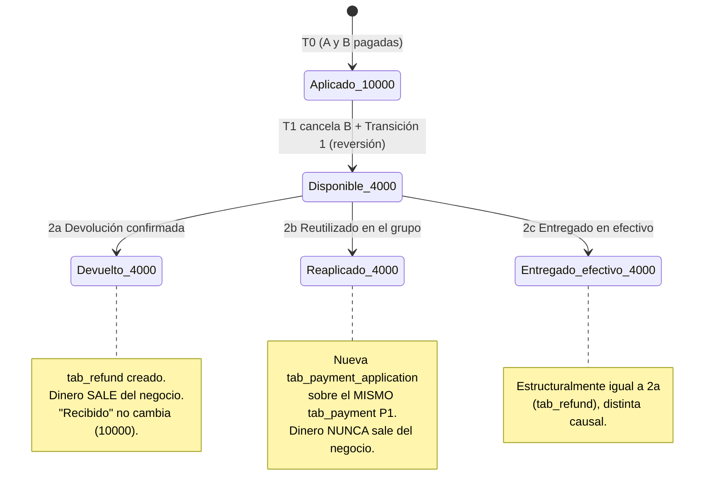

# POS_PAYMENT_AND_ACCOUNTING_SPEC — Integridad económica del POS de salón de Gesty

> **Naturaleza de este documento**: síntesis de solo lectura. Consolida la tercera auditoría de integridad económica del POS de salón (fusiones de cuentas, ciclo económico de pagos, saldo y cancelaciones, cierre de cuentas y operaciones posteriores), su expansión de Matriz B (20 temas) y sus Escenarios C numéricos (A desglosado en 4 transiciones, más B/C/D/E complementarios). No modifica código, `prisma/schema.prisma`, migraciones, servicios, rutas ni configuración. No implementa ninguna propuesta. No resuelve ninguna de las seis decisiones de negocio pendientes — se documentan como tales, con sus alternativas, sin elegir.
>
> **Convención de evidencia usada en todo el documento** (obligatoria, no intercambiable):
> - **[HECHO]** — comportamiento o estructura confirmada en el repositorio actual, con cita `archivo:línea`.
> - **[DECISIÓN APROBADA]** — definición funcional ya aceptada por el usuario, transcrita literalmente de `POS_TECHNICAL_DESIGN.md §3`. No se reabre.
> - **[PROPUESTA TÉCNICA]** — solución recomendada por esta síntesis, todavía sin aprobación explícita del usuario.
> - **[PENDIENTE]** — decisión funcional o técnica sin definir, que requiere resolución (de negocio o de implementación) antes de avanzar.
>
> **Relación con documentos preexistentes**: este documento no modifica ni reemplaza `POS_MASTER_SPEC.md`, `POS_TECHNICAL_DESIGN.md`, `KITCHEN_AUDIT.md` ni `SABROSON_POS_AUDIT.md`. Los complementa, enfocándose exclusivamente en las cuatro áreas de la tercera auditoría (fusiones/concurrencia, ciclo económico de pagos, saldo/cancelaciones, cierre y operaciones posteriores). Donde este documento corrige o matiza algo que `POS_MASTER_SPEC.md`/`POS_TECHNICAL_DESIGN.md` daban por sentado (p. ej. la mutabilidad de `amount_applied`, o la etiqueta "DECISIÓN APROBADA" sobre el mecanismo de fusión pairwise), se señala explícitamente con la cita exacta del documento original.
>
> **Verificado antes de redactar este documento**: se reinspeccionó `POS_MASTER_SPEC.md` completo para mantener coherencia de citas y referencias cruzadas, y se reconfirmaron contra el código real las citas de `pg_advisory_xact_lock` (`src/services/checkout.service.ts:87-100,166`) y del patrón de claim/CAS de facturación (`src/services/invoicing/invoice.service.ts:56,125,167,477`) — ambas siguen vigentes sin cambios respecto a lo citado en la auditoría original.
>
> **Nota de origen explícita, conforme al encargo**: se buscó exhaustivamente en todo el repositorio (código, documentación y `git log --all`) cualquier documento de "segunda auditoría" independiente que contuviera `effective_root_id`, `tab_refund`, `tab_payment_application_reversal` o `table_tab_merge_event`. **No existe ningún documento así.** Todo lo que este documento llama "modelo de raíz efectiva" o "separación reversión/devolución" es una **propuesta técnica de esta síntesis**, no la ratificación de un trabajo previo. El mecanismo que sí está documentado previamente es `table_tab_merge{primary_tab_id, merged_tab_id}` (`POS_MASTER_SPEC.md:100-104,120-126`).

---

## A. Alcance y principios arquitectónicos

Este documento cubre exclusivamente las cuatro áreas de la tercera auditoría: (1) fusiones de cuentas y concurrencia, (2) ciclo económico de pagos/aplicaciones/reversos/devoluciones, (3) saldo económico y cancelaciones, (4) cierre de cuentas y operaciones posteriores. No reabre decisiones funcionales ya aprobadas del POS de salón (`POS_TECHNICAL_DESIGN.md §3`, los once puntos transcritos del usuario) ni repite el diseño de cocina/comandas (`KITCHEN_AUDIT.md`) salvo donde esta auditoría necesita delimitar el vínculo cocina↔economía.

### A.1 Separación de capas: consumo, cargo, pago, aplicación, devolución

Son cinco hechos económicos distintos que **nunca deben colapsarse en una sola entidad ni en un solo campo mutable**:

1. **Consumo** — lo que el cliente pidió y se registró (`orders`/`order_item`, **[HECHO]**, `prisma/schema.prisma:425-481`). Inmutable desde su creación.
2. **Cargo vigente** — cuánto se le debe cobrar realmente por ese consumo, después de aplicar correcciones (cancelaciones, ajustes administrativos). Es un valor **derivado**: `orders.total_amount` (hecho histórico, nunca se reescribe) + Σ ajustes de orden + Σ ajustes de línea. **[PROPUESTA TÉCNICA]**.
3. **Pago** — dinero que efectivamente entró al negocio (`tab_payment.amount_tendered`, **[PROPUESTA TÉCNICA]**, inexistente hoy en el repo). Hecho inmutable: nunca se edita ni se reduce, ni siquiera cuando se revierte o devuelve algo asociado a él.
4. **Aplicación** — qué parte de un pago cubre qué obligación (`tab_payment_application`, **[PROPUESTA TÉCNICA]**). Insert-only; una reversión no la edita, la compensa con una fila nueva.
5. **Devolución** — dinero que efectivamente sale del negocio hacia el cliente (`tab_refund`, **[PROPUESTA TÉCNICA]**, entidad nueva de esta síntesis, no documentada antes). Nunca se modela reutilizando `tab_payment` con signo negativo.

### A.2 Inmutabilidad de hechos históricos

Principio ya vigente en el código real para `order_item` (**[HECHO]**: cero `update`/`delete`/`upsert` sobre `order_item` fuera de su creación, confirmado por grep sobre `src/services/`) y para `fiscal_invoice` (idempotencia vía `idempotencyKey`, `src/services/invoicing/invoice.service.ts:56`). Este documento extiende el mismo principio a toda la capa económica nueva: `tab_payment`, `tab_payment_application`, `orders.total_amount` y `order_item` nunca se editan para reflejar una cancelación, un reverso o una devolución — se registra un movimiento nuevo.

### A.3 Trazabilidad

Toda corrección económica (ajuste, reverso, devolución, fusión) debe quedar registrada con actor y timestamp en una tabla de evento insert-only, siguiendo el mismo patrón ya propuesto para cocina (`kitchen_ticket_item_event`, `KITCHEN_AUDIT.md:265-273`, **[PROPUESTA TÉCNICA]** con precedente de diseño) — nunca sobrescribiendo `status`/`updated_at` en la fila principal.

### A.4 Correcciones vía nuevos movimientos, nunca destructivas

Ningún escenario de esta auditoría (cancelación, reverso, devolución, fusión, corrección post-cierre) se resuelve con `UPDATE`/`DELETE` sobre un hecho económico ya confirmado. Siempre es una fila nueva que compensa, nunca una edición. Esto es lo que permite reconstruir el estado económico completo de cualquier cuenta en cualquier momento, incluyendo estados intermedios ya superados.

### A.5 Independencia entre estado comercial, estado de cocina y obligación de pago

Tres máquinas de estado separadas que **no deben inferirse una de la otra**:
- Estado comercial de la orden (`OrderStatus`, **[HECHO]**, `prisma/schema.prisma:1011-1021`).
- Estado de preparación en cocina (`kitchen_ticket_item.status`, **[PROPUESTA TÉCNICA]**, `KITCHEN_AUDIT.md §6`).
- Obligación de pago vigente (cargo derivado, §A.1 punto 2).

Que cocina haya marcado un producto como `ready`/`delivered` **no determina automáticamente** si corresponde ajustar su cargo económico — esa es siempre una decisión explícita y separada (ver Escenario C, sección C.3).

### A.6 Prevención de sobrerreembolsos y aplicaciones duplicadas

Toda operación que mueva dinero (aplicar, revertir, devolver) debe recalcular el monto disponible **bajo lock, dentro de la misma transacción**, nunca sobre un valor leído antes de bloquear. Este documento no da por sentado que esta garantía ya existe para el dominio de pagos de salón — no existe código ni esquema aún — pero sí identifica los dos patrones reales del repo que deben reutilizarse: `pg_advisory_xact_lock` (`src/services/checkout.service.ts:87-100`) y compare-and-swap vía `UPDATE ... WHERE status = X` (recomendado para cocina en `KITCHEN_AUDIT.md:175-176`, con precedente de relectura bajo lock en `claimInvoiceRow`/`decideFromExisting`, `src/services/invoicing/invoice.service.ts:125,167`).

### A.7 Compatibilidad con delivery/take-away existentes

Toda entidad nueva de este documento (`table_tab`, `tab_payment`, `order_adjustment`, etc.) debe ser opcional para las órdenes de delivery/take-away ya existentes. El punto de integración ya identificado y no modificado por este documento es `orders.table_tab_id` nullable (`POS_TECHNICAL_DESIGN.md §4.B`, **[PROPUESTA TÉCNICA]** ya documentada previamente) — las órdenes sin `table_tab_id` siguen su flujo actual (`OrderPaymentStatus` binario, `payment_intent`, `payment_proof`) sin que el ledger de salón las toque. No se reabre esta decisión aquí.

---

## B. Matriz B — los 20 temas completos

> Catorce temas tienen una propuesta técnica resuelta (sin aprobación de usuario pendiente para la *estructura*, aunque alguno tenga matices operativos menores). Seis temas (**9, 10, 15, 16, 19, 20**) son decisiones de negocio que esta síntesis **no resuelve** — se presentan con sus alternativas y su impacto, nunca con una alternativa elegida. Ver detalle de las seis en la Sección E.

### B.1 — Estrategia de fusiones: pairwise vs. `effective_root_id`

- **Problema que resuelve**: cómo representar que dos o más cuentas (`table_tab`) se consolidan en un único grupo económico sin reasignar ni reescribir su historial.
- **Alternativas evaluadas**: (a) `table_tab_merge{primary_tab_id, merged_tab_id}` pairwise, tal como está documentado en `POS_MASTER_SPEC.md:100-104,120-126`; (b) `effective_root_id` autoreferencial con cascada single-hop transaccional (propuesta de esta auditoría).
- **Propuesta técnica**: (b). Toda fila raíz cumple `id = effective_root_id`. Al fusionar, se actualiza en cascada, en la misma transacción, el `effective_root_id` de **todas** las filas que apuntaban a la raíz absorbida — nunca solo la fila directamente fusionada.
- **Justificación**: el escenario obligatorio de la auditoría (A absorbe B, A absorbe C, D absorbe A) demuestra que (a) no resuelve la fusión transitiva sin recorrido recursivo en cada lectura de saldo; ningún documento previo especifica ese recorrido. (b) resuelve el grupo completo con una sola igualdad, trasladando el costo (barato a esta escala) al momento de la fusión.
- **Impacto en modelo de datos/operaciones**: nueva columna `table_tab.effective_root_id` (self-FK), índice `@@index([effective_root_id])`, trigger (SQL manual) que garantice que `effective_root_id` siempre apunta a una fila autorreferencial.
- **Estado de resolución**: el **principio** ("mesas se agrupan/transfieren sin alterar historial") es **[DECISIÓN APROBADA]** (`POS_TECHNICAL_DESIGN.md:85`, punto 5 de los once transcritos). El **mecanismo específico** es **[PROPUESTA TÉCNICA]** — pese a que `POS_TECHNICAL_DESIGN.md:115` etiqueta el mecanismo pairwise como "DECISIÓN APROBADA", esa etiqueta no corresponde a nada transcrito literalmente del usuario; se corrige aquí explícitamente.

### B.2 — Historial de fusiones

- **Problema que resuelve**: auditar quién fusionó qué cuentas, cuándo, y cuál era la raíz antes/después — sin esta trazabilidad, una fusión es indistinguible de una corrupción de datos.
- **Alternativas evaluadas**: (a) ninguna tabla de evento, solo la relación `table_tab_merge` como estado final; (b) `table_tab_merge_event{absorbed_tab_id, root_before_id, root_after_id, actor_user_id, merged_at}`, insert-only.
- **Propuesta técnica**: (b).
- **Justificación**: `POS_MASTER_SPEC.md:100-104` no incluye actor ni garantiza explícitamente que la fila sea insert-only más allá de la ausencia de `update`. Es el mismo defecto que ya se evitó para cocina con `kitchen_ticket_item_event` (`KITCHEN_AUDIT.md:265-273`).
- **Impacto en modelo de datos/operaciones**: tabla nueva, totalmente expresable en Prisma (sin SQL manual).
- **Estado de resolución**: **[PROPUESTA TÉCNICA]**.

### B.3 — Concurrencia de fusiones

- **Problema que resuelve**: evitar que dos fusiones simultáneas sobre las mismas cuentas corrompan la cascada de `effective_root_id`.
- **Alternativas evaluadas**: (a) advisory lock único por `business_id`; (b) advisory locks por las raíces involucradas, en orden determinístico.
- **Propuesta técnica**: (a) para el MVP; (b) como optimización diferible si el volumen de fusiones simultáneas lo justifica.
- **Justificación**: a la escala de un restaurante (fusiones esporádicas, pocos usuarios concurrentes), (a) es más simple, elimina por construcción el riesgo de deadlock (un solo lock, nunca dos en orden distinto) y el costo de serializar todas las fusiones de un negocio es despreciable. Se aclara explícitamente que la atomicidad de que ningún lector vea una cascada a medias la da el **commit transaccional bajo MVCC de Postgres**, no el lock por sí solo — el lock solo serializa a los escritores entre sí.
- **Impacto en modelo de datos/operaciones**: ninguno de esquema; es un patrón de código (`pg_advisory_xact_lock`, mismo mecanismo de `src/services/checkout.service.ts:87-100`).
- **Estado de resolución**: **[PROPUESTA TÉCNICA]**.

### B.4 — Reversión de aplicaciones

- **Problema que resuelve**: representar que una aplicación de pago previa deja de corresponder a una obligación (p. ej. porque la orden se canceló), sin negar que el dinero fue aplicado en su momento.
- **Alternativas evaluadas**: (a) editar/borrar la aplicación original; (b) `tab_payment_application_reversal{application_id, amount, reason, actor_user_id, created_at}` como fila nueva insert-only.
- **Propuesta técnica**: (b).
- **Justificación**: (a) viola el principio de inmutabilidad (§A.2) y pierde la capacidad de reconstruir "qué se aplicó cuándo". El diseño vigente (`POS_MASTER_SPEC.md:204`) ya pide "fila nueva... nunca UPDATE/DELETE" pero no nombra esta entidad como separada de la devolución.
- **Impacto en modelo de datos/operaciones**: tabla nueva, con validación transaccional de que el monto revertido no exceda el remanente de la aplicación original (bajo lock de fila).
- **Estado de resolución**: **[PROPUESTA TÉCNICA]**.

### B.5 — Devoluciones reales

- **Problema que resuelve**: representar que dinero sale físicamente del negocio hacia el cliente, como hecho distinto de "dejar de aplicar un pago a una obligación".
- **Alternativas evaluadas**: (a) `tab_payment` nueva con `amount_applied` negativo (`POS_MASTER_SPEC.md:205`); (b) entidad `tab_refund{tab_payment_id, amount, status, external_ref, idempotency_key}` separada.
- **Propuesta técnica**: (b).
- **Justificación**: (a) reutiliza la entidad de "dinero recibido" para representar "dinero entregado" — impide, por ejemplo, calcular cuánto entró realmente sin filtrar por signo, y mezcla dos hechos con ciclos de vida distintos (una devolución puede quedar `pending` esperando confirmación externa; un pago recibido no tiene ese estado). Confirmado por grep: cero resultados de `refund`/`reversal` en todo `src/` — no hay precedente de código que contradiga esta elección.
- **Impacto en modelo de datos/operaciones**: tabla nueva con máquina de estados `pending/confirmed/rejected`.
- **Estado de resolución**: **[PROPUESTA TÉCNICA]**.

### B.6 — Dinero sin aplicar

- **Problema que resuelve**: saber en todo momento cuánto de lo recibido no está cubriendo ninguna obligación vigente.
- **Alternativas evaluadas**: (a) campo `tab_payment.amount_applied` mutable, actualizado en cada aplicación/reversión (`POS_MASTER_SPEC.md:186`); (b) valor derivado en cada lectura: `tendered − Σaplicaciones + Σreversiones − Σdevuelto − Σpendiente_de_devolución`.
- **Propuesta técnica**: (b).
- **Justificación**: (a) contradice el principio de inmutabilidad ya vigente en el resto del sistema (`order_item`, `fiscal_invoice`) y obligaría a reescribir el campo ante cada reversión — exactamente el patrón de mutación que el repo real evita deliberadamente.
- **Impacto en modelo de datos/operaciones**: elimina un campo propuesto previamente (`amount_applied` como columna); agrega únicamente índices para que la agregación sea eficiente.
- **Estado de resolución**: **[PROPUESTA TÉCNICA]**.

### B.7 — Vuelto

- **Problema que resuelve**: representar la diferencia entre lo entregado por el cliente y lo aplicado, cuando el cliente paga de más intencionalmente para recibir cambio.
- **Alternativas evaluadas**: ninguna alternativa estructural real — el cálculo (`amount_tendered − amount_applied`) ya está bien planteado en `POS_MASTER_SPEC.md:203`; lo único que varía es si se deriva (consistente con B.6) o se cachea.
- **Propuesta técnica**: recalcular siempre desde la agregación derivada de B.6, nunca desde un `amount_applied` mutable.
- **Justificación**: el soporte a pagos parciales y vuelto ya fue aprobado como principio (`POS_TECHNICAL_DESIGN.md:86`, decisión #6 de los once transcritos); lo que faltaba resolver era solo la mecánica de cálculo correcta, dependiente de B.6.
- **Impacto en modelo de datos/operaciones**: ninguno adicional a B.6.
- **Estado de resolución**: el principio es **[DECISIÓN APROBADA]**; la mecánica derivada es **[PROPUESTA TÉCNICA]**.

### B.8 — Devoluciones parciales

- **Problema que resuelve**: permitir devolver menos del total disponible de un pago, en una o varias solicitudes sucesivas.
- **Alternativas evaluadas**: (a) una sola devolución por pago, por el monto total disponible; (b) múltiples filas `tab_refund` por el mismo `tab_payment`, cada una validada contra el disponible recalculado en el momento de la solicitud.
- **Propuesta técnica**: (b).
- **Justificación**: el Escenario D (sección C.4) demuestra que el riesgo real no es de modelado de datos, sino de concurrencia: dos solicitudes simultáneas deben recalcular el disponible bajo el mismo lock de fila, nunca sobre un valor leído antes de bloquear.
- **Impacto en modelo de datos/operaciones**: ninguno adicional a B.5; depende del patrón transaccional de D.1 (sección D).
- **Estado de resolución**: **[PROPUESTA TÉCNICA]**.

### B.9 — FIFO vs. proporcional para aplicar pagos *(decisión de negocio pendiente)*

- **Problema que resuelve**: cuando un mismo pago cubre dos o más órdenes y se cancela solo una de ellas, qué aplicación específica se revierte (y en qué proporción, si el pago cubría más de dos órdenes).
- **Alternativas evaluadas**: (a) FIFO — se revierte primero la aplicación más reciente, o la correspondiente exactamente a la orden cancelada si es identificable unívocamente; (b) proporcional — se revierte una fracción de cada aplicación vigente, proporcional a su peso en el pago total.
- **Propuesta técnica**: **no se elige ninguna** — es una decisión de negocio pura, sin preferencia técnica entre ambas; ambas son perfectamente representables con el mismo modelo de `tab_payment_application_reversal`.
- **Justificación de por qué no se resuelve aquí**: con dos órdenes y montos que calzan exactamente (como en el Escenario A), ambas alternativas dan el mismo resultado numérico — la divergencia solo aparece con tres o más órdenes de montos desiguales bajo un mismo pago, donde FIFO y proporcional producen reversos distintos.
- **Impacto en modelo de datos/operaciones**: ninguno estructural — es un parámetro de la lógica de servicio que decide qué `application_id` y qué monto usar al generar el reverso.
- **Estado de resolución**: **[PENDIENTE]** — decisión de negocio, registrada en la Sección E.

### B.10 — Excedentes entre cuentas *(decisión de negocio pendiente)*

- **Problema que resuelve**: si un excedente de pago (dinero sin aplicar, ver B.6) puede reutilizarse en una obligación de una cuenta distinta de donde se originó.
- **Alternativas evaluadas**: (a) el excedente solo puede reaplicarse dentro del mismo grupo (`effective_root_id`) de donde se originó el pago; (b) el excedente puede cruzar hacia cualquier cuenta del mismo negocio, incluso sin relación de fusión, funcionando como una suerte de "crédito" del cliente.
- **Propuesta técnica**: **no se elige ninguna**. El encargo original de esta auditoría es explícito: no introducir una entidad de crédito transferible entre cuentas sin demostrar un caso de uso necesario para el MVP — y no se encontró ninguno en los documentos auditados.
- **Justificación de por qué no se resuelve aquí**: (a) no requiere ninguna entidad nueva (es una `tab_payment_application` normal, dentro del mismo grupo); (b) sí requeriría modelar una noción de "cuenta corriente de cliente" independiente de cualquier `table_tab`, con sus propias reglas de expiración/aplicabilidad — una pieza sustancialmente mayor, no justificada hoy.
- **Impacto en modelo de datos/operaciones**: (a) ninguno adicional; (b) requeriría una entidad nueva no diseñada por ninguna auditoría previa.
- **Estado de resolución**: **[PENDIENTE]** — decisión de negocio, registrada en la Sección E.

### B.11 — Fórmula del saldo económico

- **Problema que resuelve**: calcular correctamente cuánto debe una cuenta, sin asumir automáticamente la fórmula cuestionada por el encargo (`orders.total_amount − Σ order_item_adjustment.amount_adjusted`).
- **Alternativas evaluadas**: (a) la fórmula cuestionada, restando ajustes de línea directamente contra el total de orden; (b) separar explícitamente nivel de orden y nivel de línea antes de sumar: `Σ(orders.total_amount + Σ order_adjustment de esa orden + Σ order_item_adjustment de sus líneas)` del grupo completo, menos las aplicaciones netas de reversiones.
- **Propuesta técnica**: (b).
- **Justificación**: se confirmó por inspección directa del código real que `orders.total_amount` mezcla componentes de **nivel de orden** (`delivery_fee`, `payment_adjustment`, `promotion_discount`; `prisma/schema.prisma:456-462`) con componentes de **nivel de línea** (`order_item.unit_price/list_price/discount_amount`; `prisma/schema.prisma:429-437`). Restar un ajuste de línea contra ese total mezclado produce un saldo incorrecto en cualquier caso con envío, recargo o promoción.
- **Impacto en modelo de datos/operaciones**: requiere la entidad nueva de B.13 (`order_adjustment`) además de la ya propuesta por cocina (B.12, `order_item_adjustment`).
- **Estado de resolución**: **[PROPUESTA TÉCNICA]**.

### B.12 — Ajustes por ítem

- **Problema que resuelve**: corregir el cargo económico de una línea específica (cancelación parcial, error de carga) sin editar `order_item`.
- **Alternativas evaluadas**: ninguna alternativa estructural — la entidad ya estaba diseñada (`order_item_adjustment`, `KITCHEN_AUDIT.md:64,106,168`), pero acotada explícitamente al contexto de cocina.
- **Propuesta técnica**: generalizar su uso a cualquier corrección económica de línea (no solo las originadas en cocina), con un vínculo opcional (`kitchen_ticket_item_event_id`) cuando la causal sí viene de cocina.
- **Justificación**: la misma estructura sirve, sin cambios, para cualquier corrección de línea — no hay razón para limitarla artificialmente a un solo origen causal.
- **Impacto en modelo de datos/operaciones**: ninguno adicional al ya propuesto por `KITCHEN_AUDIT.md`, salvo hacer el vínculo a cocina explícitamente opcional/nullable.
- **Estado de resolución**: **[PROPUESTA TÉCNICA]**.

### B.13 — Ajustes por orden

- **Problema que resuelve**: corregir componentes económicos que viven a nivel de orden completa (`delivery_fee`, `payment_adjustment`, `promotion_discount`) y que ningún ajuste por línea puede representar.
- **Alternativas evaluadas**: ninguna — esta entidad **no existe en ningún documento previo** (`POS_MASTER_SPEC.md`, `KITCHEN_AUDIT.md`, `POS_TECHNICAL_DESIGN.md`). Es una pieza faltante identificada por esta auditoría, no una alternativa entre dos opciones ya consideradas.
- **Propuesta técnica**: `order_adjustment{order_id, amount_adjusted, concept, reason, actor_user_id, created_at}`.
- **Justificación**: sin ella, no hay forma de corregir un `delivery_fee` o una `promotion_discount` mal calculados sin tocar directamente el campo de `orders`, rompiendo la inmutabilidad (§A.2).
- **Impacto en modelo de datos/operaciones**: entidad completamente nueva, necesaria para que la fórmula de B.11 sea correcta.
- **Estado de resolución**: **[PROPUESTA TÉCNICA]** (nueva de esta auditoría).

### B.14 — Cancelaciones de cocina

- **Problema que resuelve**: qué debe pasar en la capa de cocina cuando se cancela un producto, sin que esa capa se convierta en fuente de verdad económica.
- **Alternativas evaluadas**: (a) el estado de cocina determina automáticamente si corresponde ajustar el cargo; (b) las dos capas (cocina y economía) son máquinas de estado independientes, referenciadas entre sí solo opcionalmente.
- **Propuesta técnica**: (b).
- **Justificación**: confirmado en el código real que hoy la única cancelación posible es de orden completa (`cancelPlacedOrderAndNotifyAdmin`, `src/services/order.service.ts:190-214`), y que ese flujo **no toca** `payment_status` ni crea ningún registro económico — es evidencia directa de que, incluso hoy, cambiar un estado comercial/operativo nunca implica automáticamente una consecuencia económica en este sistema.
- **Impacto en modelo de datos/operaciones**: ninguno adicional a B.12 (`order_item_adjustment.kitchen_ticket_item_event_id` como vínculo opcional).
- **Estado de resolución**: **[PROPUESTA TÉCNICA]** en la arquitectura; la política específica de autorización (quién puede cancelar en cocina) sigue **[PENDIENTE]** por `KITCHEN_AUDIT.md §11/§15`, no resuelta aquí tampoco.

### B.15 — Cancelaciones con productos preparados *(decisión de negocio pendiente)*

- **Problema que resuelve**: si corresponde cobrar igual un producto cancelado después de iniciada o completada su preparación, y quién autoriza esa decisión caso por caso.
- **Alternativas evaluadas**: (a) se cobra igual (el costo de preparación ya se incurrió, se trata como venta); (b) se anula el cargo igual (se registra como pérdida de mercadería/`wasted:true`).
- **Propuesta técnica**: **no se elige ninguna**. El Escenario C (sección C.3) muestra que ambas alternativas son perfectamente representables con el mismo modelo (`order_item_adjustment` presente o ausente) — la auditoría no tiene elementos de negocio para preferir una.
- **Justificación de por qué no se resuelve aquí**: es la decisión pendiente más repetida en las auditorías previas (`KITCHEN_AUDIT.md:106,126,311`), sin que ninguna la haya resuelto; tampoco corresponde a esta síntesis resolverla.
- **Impacto en modelo de datos/operaciones**: ninguno estructural — ambas alternativas usan la misma entidad; la diferencia es si se inserta o no la fila de ajuste, y quién está autorizado a decidirlo.
- **Estado de resolución**: **[PENDIENTE]** — decisión de negocio, registrada en la Sección E.

### B.16 — Cierre de cuentas *(decisión de negocio pendiente en su alcance exacto)*

- **Problema que resuelve**: qué condiciones deben cumplirse para permitir cerrar una `table_tab`, y cuáles de ellas deben bloquear el cierre frente a cuáles solo deben generar una alerta de conciliación posterior.
- **Alternativas evaluadas**: (a) una lista única de condiciones que siempre bloquean (saldo=0, sin más matices); (b) dos listas separadas — condiciones que bloquean de verdad (saldo≠0, ajustes de orden/ítem en estado abierto) y condiciones que solo generan alerta (devolución `pending`/timeout, facturación fallida, pago pendiente de conciliar).
- **Propuesta técnica**: (b).
- **Justificación**: el encargo es explícito en que una operación externa incierta (p. ej. un timeout de un proveedor de pago al confirmar una devolución) no debe bloquear indefinidamente el funcionamiento del restaurante. El principio general de exigir saldo=0 para cerrar ya es consistente con haber aprobado un ledger con reversos (`POS_TECHNICAL_DESIGN.md:86`, decisión #6) — lo que falta es la lista exacta y exhaustiva de qué más bloquea.
- **Impacto en modelo de datos/operaciones**: la verificación de cierre pasa a ser una consulta agregada sobre varias entidades (saldo derivado + ajustes abiertos), no solo un chequeo de `total_amount`.
- **Estado de resolución**: el principio general (saldo=0 como condición) es **[DECISIÓN APROBADA]** por extensión de la decisión #6; la lista exacta y exhaustiva de qué específicamente bloquea vs. alerta es **[PENDIENTE]** — decisión de negocio, registrada en la Sección E.

### B.17 — Devoluciones pendientes o con resultado externo desconocido

- **Problema que resuelve**: cómo tratar una devolución cuyo proveedor externo no respondió (timeout), sin tratarlo como un rechazo definitivo ni como una confirmación.
- **Alternativas evaluadas**: (a) tratar el timeout como rechazo automático (libera el hold, pero puede ser incorrecto si la devolución sí se procesó del lado del proveedor); (b) el estado permanece `pending` indefinidamente hasta reconciliación explícita, sin inferir ningún resultado.
- **Propuesta técnica**: (b).
- **Justificación**: el encargo lo exige explícitamente ("no tratar un timeout del proveedor como rechazo definitivo"). Mantener el hold activo (disponible=0 para ese monto) hasta que se conozca el resultado real evita tanto el sobre-reembolso como la pérdida silenciosa de un reembolso que sí ocurrió.
- **Impacto en modelo de datos/operaciones**: `tab_refund.status` nunca transiciona a `confirmed`/`rejected` por inferencia; requiere un mecanismo de reconciliación posterior (job o consulta al proveedor) no diseñado en detalle por esta auditoría.
- **Estado de resolución**: **[PROPUESTA TÉCNICA]** en el principio; el mecanismo exacto de reconciliación (job periódico vs. consulta en caliente) queda **[PENDIENTE]** como detalle de implementación, no de negocio.

### B.18 — Operaciones posteriores al cierre

- **Problema que resuelve**: cómo representar una corrección (devolución tardía, cargo omitido, error de cancelación) sobre una cuenta ya cerrada, sin reabrirla.
- **Alternativas evaluadas**: (a) crear una entidad nueva `post_close_adjustment`; (b) reutilizar las entidades ya propuestas para operación normal (`order_item_adjustment`, `order_adjustment`, `tab_payment`, `tab_refund`), vinculadas a la cuenta histórica, usando `table_tab.status='open'` solo como guardia de "nueva ronda"/"nueva asignación de mesa".
- **Propuesta técnica**: (b).
- **Justificación**: el encargo exige justificar `post_close_adjustment` antes de proponerla. El Escenario E (sección C.5) demuestra, caso por caso, que ninguna corrección post-cierre necesita una entidad nueva — todas se resuelven con las ya propuestas, siempre que el guard de `status='open'` se interprete de forma acotada y no como bloqueo genérico de cualquier escritura relacionada con la cuenta.
- **Impacto en modelo de datos/operaciones**: ninguna entidad nueva; sí requiere que la lógica de servicio nunca use `table_tab.status` como guard universal.
- **Estado de resolución**: **[PROPUESTA TÉCNICA]** en la reutilización de entidades (bloqueada parcialmente en la capa fiscal, ver B.20); **quién autoriza** una corrección administrativa post-cierre sigue **[PENDIENTE]** — decisión de negocio, registrada en la Sección E.

### B.19 — Fusiones con cuentas cerradas *(decisión de negocio pendiente)*

- **Problema que resuelve**: si se permite fusionar una cuenta cerrada con otra (abierta o cerrada), o si se rechaza siempre.
- **Alternativas evaluadas**: (a) rechazar siempre toda fusión que involucre una cuenta `closed`, en cualquiera de los dos roles; (b) permitirlo como una operación administrativa excepcional, separada del flujo normal de "unir mesas", para corregir errores operativos (p. ej. dos cuentas abiertas por error para la misma mesa, ambas ya cerradas).
- **Propuesta técnica**: **no se elige ninguna** entre las dos como regla definitiva, aunque se señala que (a) es la opción que no requiere ningún diseño adicional ni riesgo de contradecir "nunca reabrir una cuenta cerrada" (`POS_TECHNICAL_DESIGN.md:125`).
- **Justificación de por qué no se resuelve aquí**: no se encontró, en ninguno de los documentos auditados, un caso de uso de negocio que demuestre la necesidad de (b). Sin ese caso de uso, el encargo exige no construir la excepción.
- **Impacto en modelo de datos/operaciones**: (a) ninguno — basta con que la validación de fusión (B.1) rechace cuando alguna raíz involucrada tiene `status='closed'`; (b) requeriría diseñar un flujo administrativo separado, con su propia autorización, no cubierto por esta auditoría.
- **Estado de resolución**: **[PENDIENTE]** — decisión de negocio, registrada en la Sección E.

### B.20 — Notas de crédito y correcciones fiscales *(decisión de negocio pendiente, sobre un bloqueo ya confirmado como hecho)*

- **Problema que resuelve**: cómo reflejar fiscalmente una corrección económica (cancelación, ajuste) sobre una orden que ya fue facturada.
- **Alternativas evaluadas**: no hay alternativas técnicas reales que evaluar aquí — el modelo (`fiscal_invoice{kind: credit_note, reversed_invoice_id}`) ya está diseñado en `POS_MASTER_SPEC.md:217`. Lo que no existe es el **servicio emisor**.
- **Propuesta técnica**: ninguna nueva — se confirma el bloqueo ya señalado por auditorías previas y se recomienda priorizar su desarrollo o aceptar explícitamente la limitación para el MVP.
- **Justificación**: confirmado directamente contra el código real: `FiscalInvoiceKind.credit_note` existe en el enum (`prisma/schema.prisma:1065`) pero hay **cero resultados** de grep para `credit_note`/`refund`/`reversal` en todo `src/services/invoicing/` y `src/routes/`. Es un bloqueante preexistente, **independiente del POS de salón** — el POS de salón simplemente lo hereda y lo expone antes (cualquier cancelación con factura ya emitida lo golpea).
- **Impacto en modelo de datos/operaciones**: ninguno nuevo de esquema; el bloqueo es de **implementación de servicio**, no de modelo de datos.
- **Estado de resolución**: el bloqueo en sí es **[HECHO]**; **cuándo y con qué prioridad resolverlo** es **[PENDIENTE]** — decisión de negocio/priorización, registrada en la Sección E.

---

## C. Escenarios C

### C.1 Escenario A — desglosado en 4 transiciones *(complementario, elaborado para esta síntesis; la auditoría original solo lo narraba en prosa)*

**Setup (T0)** — modelo propuesto, ninguna fila de estas existe hoy en el repositorio real:

- Orden A: `total_amount = 6000`. Orden B: `total_amount = 4000`.
- `tab_payment` P1: `amount_tendered = 10000`, `status = confirmed`.
- `tab_payment_application` app1: `payment=P1, order=A, amount=6000`.
- `tab_payment_application` app2: `payment=P1, order=B, amount=4000`.

| Variable | T0 |
|---|---|
| Recibido acumulado | 10000 |
| Aplicado vigente (Σaplicaciones − Σreversiones) | 10000 |
| Aplicaciones revertidas | 0 |
| Devuelto confirmado | 0 |
| Pendiente de devolución | 0 |
| Disponible sin aplicar | 0 |
| Saldo orden A | 0 |
| Saldo orden B | 0 |
| Saldo total del grupo | 0 |

**T1 — Se cancela la orden B**: `order_adjustment{order=B, amount_adjusted=-4000}` → cargo vigente de B = 4000 − 4000 = 0.

**Transición 1 — Reversión de la aplicación de B**: se inserta `tab_payment_application_reversal{application=app2, amount=4000, reason:'order_cancelled'}`. El `tab_payment` P1 original **no se edita**.

| Variable | post-Transición 1 |
|---|---|
| Recibido acumulado | 10000 (sin cambio — hecho inmutable) |
| Aplicado vigente | 6000 (solo A) |
| Aplicaciones revertidas | 4000 |
| Devuelto confirmado | 0 |
| Pendiente de devolución | 0 |
| **Disponible sin aplicar** | 10000 − 6000 − 0 − 0 = **4000** |
| Saldo orden A | 0 |
| Saldo orden B | 0 |
| Saldo total del grupo | (6000 + 0) − 6000 = **0** |

A partir de este estado (saldo total = 0, pero con **$4000 disponibles sin aplicar**), se abren tres caminos **alternativos y excluyentes entre sí**, todos parten del mismo punto, y todos terminan con saldo = 0 pero con **consecuencias contables distintas**:

**Transición 2a — Devolución confirmada al cliente**:
- `tab_refund{tab_payment_id: P1, amount: 4000, status: pending}` — bajo lock de P1, disponible(4000) ≥ solicitado(4000) → aceptada.
- Confirmación externa (CAS `pending → confirmed`).

| Variable | post-2a |
|---|---|
| Recibido acumulado | 10000 |
| Aplicado vigente | 6000 |
| Devuelto confirmado | **4000** |
| Pendiente de devolución | 0 |
| Disponible sin aplicar | 0 |
| Saldo total del grupo | 0 |
| **Consecuencia contable** | El dinero **salió** del negocio. "Recibido" (10000) y "devuelto" (4000) son dos hechos separados que coexisten; el neto en caja es 6000, pero nunca se resta uno del otro en el campo `amount_tendered`. |

**Transición 2b (alternativa) — El cliente reutiliza el dinero dentro del mismo grupo de cuentas**, suponiendo una Orden C=4000 en el mismo `effective_root_id`:
- Se inserta una **nueva** `tab_payment_application{payment: P1 (el mismo), order: C, amount: 4000}`. **Nunca se crea un `tab_refund`.**

| Variable | post-2b |
|---|---|
| Recibido acumulado | 10000 |
| Aplicado vigente | 6000(A) + 4000(C) = **10000** |
| Devuelto confirmado | 0 |
| Disponible sin aplicar | 0 |
| Saldo orden C | 0 |
| Saldo total del grupo (A+B+C) | (6000+0+4000) − 10000 = **0** |
| **Consecuencia contable** | El dinero **nunca salió** del negocio — solo cambió qué obligación cubre, dentro del mismo `tab_payment`. Numéricamente el saldo final es idéntico a 2a (0), pero el flujo de caja real es distinto: en 2a el negocio entrega 4000 y los vuelve a recibir después si el cliente pide algo nuevo; en 2b ese movimiento de caja nunca ocurre. |

**Transición 2c (alternativa) — Se entrega como efectivo/vuelto**:
- Estructuralmente **idéntica a 2a** (`tab_refund{amount:4000, method:'cash'}`, mismo CAS `pending→confirmed`). Estado numérico final idéntico a 2a.
- **Consecuencia contable**: la única diferencia respecto a 2a es la causal/metadata (`reason:'cash_change_after_cancellation'` vs. `reason:'refund_requested'`) — no la estructura de datos ni ningún número. Se señala explícitamente que esto **no** es "vuelto" en el sentido clásico (que ocurre en el mismo acto de pago cuando el cliente paga de más intencionalmente): aquí el excedente surgió **después**, por una cancelación.

### C.2 Escenario B — pago parcial y cancelación posterior *(complementario, elaborado para esta síntesis)*

**Setup (T0)**: Orden D: `total_amount = 9000`. `tab_payment` P2: `amount_tendered = 3000`, `status=confirmed`. `tab_payment_application` app3: `payment=P2, order=D, amount=3000`.

| Variable | T0 |
|---|---|
| Recibido acumulado | 3000 |
| Aplicado vigente | 3000 |
| Disponible sin aplicar | 0 |
| **Saldo orden D** | 9000 − 3000 = **6000** (deuda pendiente real) |

**T1 — Se cancela la orden D completa**: `order_adjustment{order=D, amount_adjusted=-9000}` → cargo vigente de D = 9000 − 9000 = 0.

**Transición — Reversión de la aplicación de 3000**: `tab_payment_application_reversal{application=app3, amount=3000, reason:'order_cancelled'}`.

| Variable | post-transición |
|---|---|
| Recibido acumulado | 3000 (sin cambio) |
| Aplicado vigente | 3000 − 3000 = **0** |
| Aplicaciones revertidas | 3000 |
| Disponible sin aplicar | 3000 − 0 − 0 − 0 = **3000** |
| Saldo orden D | 0 (cargo 0, aplicado 0) |
| Saldo total | 0 |

A partir de aquí, las mismas tres alternativas del Escenario A (devolver / reutilizar en el grupo / entregar en efectivo) se aplican de forma idéntica sobre este monto de 3000.

**Nota explícita sobre B.9 (FIFO vs. proporcional)**: este escenario, al tener **una sola aplicación por pago**, **no ejercita** la decisión pendiente de FIFO vs. proporcional — esa decisión solo se vuelve relevante cuando un mismo pago cubre dos o más órdenes simultáneamente y se cancela solo una de ellas (como en el Escenario A, o en una variante de este Escenario B con una Orden D' adicional cubierta por el mismo P2).

### C.3 Escenario C — cancelación de un producto, separando cocina de economía *(complementario, elaborado para esta síntesis)*

**Setup**: Orden E, 3 ítems — `e1` "Bife de chorizo" $5000, `e2` "Papas fritas" $1500, `e3` "Gaseosa" $500. `orders.total_amount = 7000`, ya cobrada íntegramente (una `tab_payment_application` de 7000 aplicada contra E).

Se cancela `e2` ($1500) en tres situaciones de cocina distintas. **En ningún caso se asume que el estado de cocina determina automáticamente el cargo** — cada variante requiere una decisión explícita y separada, nunca inferida del estado de `kitchen_ticket_item`:

| Variante | Estado de cocina | ¿Ajuste económico aprobado? | Cargo vigente de E | Aplicado neto | Saldo | Reembolsable | Evento de cocina registrado |
|---|---|---|---|---|---|---|---|
| C.1 | No preparado (`pending`) | **Sí** — sin fricción de negocio, caso típico | 7000 − 1500 = **5500** | 5500 | 0 | hasta 1500 | `voided`, sin `wasted` |
| C.2 — "se ajusta" | En preparación (`in_progress`) | **Sí** — requiere autorización explícita (`authorized_by`, ver B.15) | **5500** | 5500 | 0 | hasta 1500 | `cancelled`, `wasted:true` |
| C.2 — "se cobra igual" | En preparación (`in_progress`) | **No** | **7000** (sin cambio) | 7000 | 0 | **0** | `cancelled` o `delivered`, **sin** `order_item_adjustment` |
| C.3 — "se ajusta" | Ya entregado | **Sí** — requiere autorización explícita | **5500** | 5500 | 0 | hasta 1500 | `delivered` + ajuste posterior |
| C.3 — "se cobra igual" | Ya entregado | **No** | **7000** (sin cambio) | 7000 | 0 | **0** | `delivered`, sin ajuste |

**Lectura obligatoria de esta tabla**: el estado de cocina (`in_progress`/`delivered`) es el **mismo** en las dos filas "se ajusta"/"se cobra igual" de cada bloque — lo único que cambia el resultado económico es la decisión explícita de autorización, nunca el estado de cocina por sí solo. Esta es la demostración concreta del principio de independencia de capas (§A.5). La política de quién autoriza y en qué casos sigue **[PENDIENTE]** (B.15) — no se elige ninguna alternativa aquí.

### C.4 Escenario D — lock transaccional, relectura del disponible e idempotencia *(complementario, elaborado para esta síntesis)*

**Setup**: `tab_payment` P3, `amount_tendered = 5000`, sin aplicaciones vigentes (disponible = 5000 desde el inicio del escenario).

| Paso | Acción | Mecanismo | Disponible recalculado bajo lock | Resultado | Devuelto confirmado | Pendiente | Disponible resultante |
|---|---|---|---|---|---|---|---|
| T1 | Solicitud Devolución #1 ($2000) | lock de fila por `tab_payment_id` | 5000 ≥ 2000 | Aceptada, `status=pending` | 0 | 2000 | 3000 |
| T2 | Confirmación Devolución #1 (CAS `pending→confirmed`) | — | — | Confirmada | **2000** | 0 | 3000 |
| T3 | Solicitud Devolución #2 ($1500) | mismo lock | 3000 ≥ 1500 | Aceptada, `status=pending` | 2000 | 1500 | 1500 |
| T4 | **Concurrente**: Confirmación de #2 vs. Solicitud de Devolución #3 ($2000) compiten por el mismo lock | Postgres serializa: una espera a la otra | Quien adquiere el lock primero recalcula: disponible = 1500 | Devolución #3 (2000 > 1500) → **rechazada**, nunca se persiste | 2000 (hasta que #2 confirme) | 1500 | 1500 |
| T5 | Confirmación de #2 (tras liberarse el lock) | CAS | — | Confirmada | **3500** (2000+1500) | 0 | **1500** |

**Qué garantiza que no haya sobre-reembolso**: no el estado `pending`/`confirmed` aislado, sino que **cada transacción que escribe (acepta una solicitud nueva o confirma una existente) recalcula el disponible bajo el mismo lock de fila antes de decidir** — el resultado no depende de qué transacción llegó primero al lock, porque la recomputación siempre es fresca.

**Qué se reutiliza del repo real y qué falta construir — sin afirmar que ya resuelven el caso POS**:
- `pg_advisory_xact_lock` (**[HECHO]**, `src/services/checkout.service.ts:87-100`, re-verificado vigente en esta síntesis) resuelve hoy un problema estructuralmente análogo (serializar la creación de una orden a partir de un draft) — **pero no existe ningún código que lo aplique a `tab_payment`/`tab_refund`**, porque esas entidades no existen todavía. Lo que se reutiliza es el **patrón**, no una función ya escrita para este caso.
- El compare-and-swap vía `UPDATE ... WHERE status = X` (**[PROPUESTA TÉCNICA]**, recomendado explícitamente para un problema análogo en `KITCHEN_AUDIT.md:175-176`, con precedente de relectura bajo lock en `claimInvoiceRow`/`decideFromExisting`, **[HECHO]**, `src/services/invoicing/invoice.service.ts:125,167,477`, re-verificado vigente) tampoco tiene hoy una implementación para `tab_refund` — es, de nuevo, el patrón el que se reutiliza, no código existente.
- **Lo que falta construir, explícitamente**: la tabla `tab_payment`/`tab_refund` misma, el servicio que aplica el lock+recálculo+CAS descrito arriba, y el mecanismo de reconciliación para el caso de timeout externo (B.17) — ninguno de estos tres existe hoy en ninguna forma, ni siquiera parcial.

### C.5 Escenario E — corrección post-cierre sin reabrir la cuenta *(complementario, elaborado para esta síntesis)*

**Setup histórico**: `table_tab` TT1 (`status=closed`, cerrada hace 3 días). Orden F: `total_amount=5000`, pagada íntegramente vía `tab_payment` P4 (una `tab_payment_application` de 5000). Saldo al momento del cierre: 0 — todo correcto en su momento.

**Hoy se descubre**: un ítem de la Orden F ($1200, "Postre") debió cancelarse y nunca se hizo — cancelación omitida, el cliente pagó de más por error administrativo.

| Paso | Acción | Qué se escribe | Qué **nunca** se modifica |
|---|---|---|---|
| 1 | Ajuste económico | `order_item_adjustment{order_item: <Postre de F>, amount_adjusted: -1200, reason:'post_close_correction', actor_user_id, created_at: hoy}` | `TT1.status` (sigue `closed`), `F.total_amount` (sigue siendo literalmente 5000 como hecho histórico), el `order_item` original |
| 2 | Reversión de lo ya aplicado de más | `tab_payment_application_reversal{application: la aplicación original de F, amount: 1200, reason:'post_close_correction'}` | La aplicación original, `P4` |
| 3 | Resultado numérico | Cargo vigente de F (derivado) = 5000 − 1200 = **3800**. Aplicado neto = 3800. **Saldo de F = 0.** Disponible sobre P4 = 5000 − 3800 = **1200** | — |
| 4 | Siguiente paso, a elección del cliente | `tab_refund` de 1200 **vinculado a P4**, nunca a `TT1` | `TT1` nunca transiciona a `open` |

**Confirmación explícita de B.18**: esta corrección no requiere ninguna entidad `post_close_adjustment` — se resuelve íntegramente con `order_item_adjustment` y `tab_payment_application_reversal`, ya propuestas para operación normal, sin que `TT1.status='closed'` impida ninguna de estas dos inserciones (el guard `open` solo gobierna "nueva ronda"/"nueva asignación de mesa", nunca la escritura de una corrección histórica).

**Tratamiento fiscal**: si ya se emitió `fiscal_invoice` sobre F por los 5000 originales, esta corrección queda **bloqueada en la capa fiscal** por la ausencia de servicio emisor de `credit_note` (B.20, **[HECHO]**, `prisma/schema.prisma:1065`, sin consumidor confirmado por grep en `src/services/invoicing/`) — el ledger de cuenta representa la corrección sin ambigüedad; la capa fiscal, hoy, no puede reflejarla.

---

## D. Invariantes transaccionales

| Invariante | ¿Respaldada hoy por un mecanismo existente en el repo? | Mecanismo a reutilizar / construir |
|---|---|---|
| **Atomicidad** de una fusión (cascada de `effective_root_id` + evento, todo o nada) | No — la entidad no existe. El *patrón* de transacción única sí existe (`createOrderFromDraftLocked` dentro de `prisma.$transaction`, `src/services/checkout.service.ts:166-180`) | Reutilizar el patrón de transacción única; construir el código específico |
| **Concurrencia** entre dos fusiones simultáneas | No — no existe `table_tab`. El patrón `pg_advisory_xact_lock` sí existe y es directamente aplicable (**[HECHO]**, `checkout.service.ts:87-100`) | Reutilizar `pg_advisory_xact_lock` por `business_id`; construir la clave de lock específica |
| **Idempotencia** de una solicitud de devolución/reversión ante reintentos | No — `tab_refund` no existe. El patrón de claim con `idempotency_key` + relectura bajo lock sí existe (**[HECHO]**, `claimInvoiceRow`/`decideFromExisting`, `invoice.service.ts:125,167,477`) | Reutilizar el patrón de claim; construir `tab_refund.idempotency_key` |
| **No-duplicación de aplicaciones** (una misma obligación no se cubre dos veces por el mismo pago en una carrera) | No — `tab_payment_application` no existe | Insert bajo transacción con recálculo fresco del saldo pendiente de la orden, mismo principio del Escenario D |
| **No-sobrerreembolso** (una devolución nunca excede el disponible, incluso con solicitudes concurrentes) | No — `tab_refund` no existe. El patrón CAS (`UPDATE ... WHERE status = X`) está recomendado para un problema análogo (**[PROPUESTA TÉCNICA]** con precedente de diseño, `KITCHEN_AUDIT.md:175-176`), no implementado aún para pagos | Construir íntegramente (ver Escenario D, sección C.4) |
| **Consistencia entre movimientos y saldos derivados** (el saldo nunca es un campo cacheado que pueda desincronizarse) | Parcial — el *principio* de "nunca cachear, siempre agregar en consulta" ya está declarado para el saldo de cuenta en `POS_MASTER_SPEC.md §3.3`, pero el propio documento lo contradice al dejar `amount_applied` como campo mutable (`POS_MASTER_SPEC.md:186`) — contradicción señalada en B.6 | Construir la agregación derivada (B.6, B.11); eliminar cualquier campo cacheado equivalente |
| **Trazabilidad** (actor + timestamp en cada corrección) | Parcial — el patrón de tabla de evento insert-only ya está diseñado para cocina (`kitchen_ticket_item_event`, `KITCHEN_AUDIT.md:265-273`), no implementado, y no existe ningún análogo para pagos/fusiones hoy | Extender el mismo patrón a `table_tab_merge_event`, `order_item_adjustment`, `order_adjustment`, `tab_payment_application_reversal`, `tab_refund` |
| **Integridad referencial** (`effective_root_id` nunca apunta a una fila no-autorreferencial; `fiscal_invoice` nunca con `order_id` y `billable_charge_id` simultáneamente nulos o ambos presentes) | Parcial — existe precedente real de CHECK constraint manual en el repo (**[HECHO]**, `reservation`, `prisma/schema.prisma:607`, comentario auto-generado "This table contains check constraints...") | Reutilizar el mismo patrón de migración SQL manual; el chequeo cruzado de `effective_root_id` requiere además un trigger (no expresable en CHECK simple) |
| **Aislamiento multi-tenant por `business_id`** | Sí, parcialmente — patrón ya implementado y disciplinado en todo el repo real (**[HECHO]**, `tenantBusinessId(req)`, confirmado en auditorías previas), pero **sin Row-Level-Security de respaldo** a nivel de Postgres (riesgo estructural preexistente, no introducido por esta síntesis) | Extender la misma disciplina manual a cada tabla nueva (`table_tab`, `tab_payment`, etc.); no hay mecanismo de respaldo a nivel de base de datos hoy para ninguna tabla del sistema |
| **Exclusión de asignación activa de mesa** (a lo sumo una fila de `table_tab_table` activa por mesa) | Parcial — no existe la tabla, pero el patrón de índice único parcial vía migración SQL manual **sí tiene precedente real y probado** (**[HECHO]**, `unique_business_pending_checkout_attempt`, `prisma/migrations/20261013220000_add_checkout_attempt/migration.sql:66-68`) | Reutilizar textualmente ese patrón para `table_tab_table(table_id) WHERE unassigned_at IS NULL` |

---

## E. Registro de decisiones pendientes

> Seis decisiones de negocio. Ninguna se resuelve en este documento. Estado uniforme: `PENDING_BUSINESS_DECISION`.

| ID | Tema | Alternativas | Consecuencias operativas | Consecuencias contables | Dependencias técnicas | Estado |
|---|---|---|---|---|---|---|
| B.9 | FIFO vs. proporcional para aplicar pagos | (a) FIFO — revierte la aplicación más reciente/identificable; (b) Proporcional — revierte una fracción de cada aplicación vigente | (a) más simple de explicar al personal de caja; (b) más "justo" cuando hay 3+ órdenes de montos desiguales bajo un mismo pago | Ambas dan el mismo resultado con 2 órdenes que calzan exactamente (Escenario A); divergen con 3+ órdenes de montos desiguales | Requiere que `tab_payment_application_reversal` exista (B.4) antes de poder implementar cualquiera de las dos | `PENDING_BUSINESS_DECISION` |
| B.10 | Excedentes entre cuentas | (a) Solo reaplicable dentro del mismo grupo (`effective_root_id`); (b) Transferible entre cualquier cuenta del negocio (crédito de cliente) | (a) no requiere ningún flujo nuevo de atención al cliente; (b) exige definir expiración, trazabilidad entre clientes distintos, posible fraude interno | (a) sin impacto adicional; (b) requiere una entidad de "cuenta corriente de cliente" no diseñada por ninguna auditoría | Ninguna adicional para (a); diseño completo nuevo para (b), no cubierto aquí | `PENDING_BUSINESS_DECISION` |
| B.15 | Cancelaciones con productos preparados | (a) Se cobra igual (venta ya incurrida); (b) Se anula el cargo (pérdida de mercadería) | (a) puede generar fricción con el cliente si el producto nunca se entregó; (b) genera costo de merma recurrente para el negocio si se abusa | (a) cargo vigente permanece 7000 (Escenario C); (b) cargo vigente baja a 5500, reembolsable hasta 1500 | Requiere `order_item_adjustment` (B.12) y definir el rol autorizado (ver también B.18) | `PENDING_BUSINESS_DECISION` |
| B.16 | Condiciones exactas de bloqueo de cierre vs. alerta | (a) Lista mínima (solo saldo≠0 bloquea, todo lo demás es alerta); (b) Lista extendida (saldo≠0 + ajustes abiertos + facturación pendiente, todo bloquea) | (a) el salón nunca queda "atascado" por un proveedor externo lento; (b) mayor control administrativo, a costa de posibles bloqueos operativos por causas ajenas al salón | Ambas requieren el saldo derivado correcto (B.11); (b) puede dejar cuentas sin cerrar por razones no controlables por el mozo/cajero | Requiere la fórmula de saldo (B.11) y el modelo de `tab_refund`/`billable_charge` para evaluar "pendiente" | `PENDING_BUSINESS_DECISION` |
| B.19 | Fusiones con cuentas cerradas | (a) Rechazar siempre; (b) Permitir como excepción administrativa auditada | (a) ninguna fricción operativa nueva; (b) requiere un flujo y una autorización separados del "unir mesas" normal | (a) sin impacto; (b) exige reabrir conceptualmente la noción de "grupo económico" de una cuenta ya cerrada, con riesgo de confundir reportes ya cerrados de un período | Ninguna adicional para (a); diseño de flujo administrativo nuevo para (b), no cubierto aquí | `PENDING_BUSINESS_DECISION` |
| B.20 | Priorización del servicio emisor de notas de crédito | (a) Priorizar su desarrollo antes de habilitar cancelaciones post-facturación en salón; (b) Aceptar la limitación documentada en el MVP (bloquear esas correcciones específicas hasta que exista) | (a) retrasa el MVP de salón; (b) deja un caso real (Escenario E con factura ya emitida) sin solución operativa hasta que se resuelva | Ninguna alternativa cambia el modelo de datos — el modelo (`fiscal_invoice{kind:credit_note}`) ya existe en diseño; lo que falta es el servicio | Depende de un desarrollo ajeno al POS de salón, ya identificado como deuda preexistente | `PENDING_BUSINESS_DECISION` |

---

## F. Decisiones técnicas resueltas

> Ocho decisiones, ya respaldadas por el análisis de las secciones B, C y D de este documento. No se agregó ninguna adicional a las ya sustentadas por la auditoría y su expansión.

| # | Decisión | Justificación | Consecuencia arquitectónica | Estado |
|---|---|---|---|---|
| 1 | Mecanismo de fusión: `effective_root_id` + cascada single-hop, en vez de `table_tab_merge` pairwise | El pairwise no resuelve la fusión transitiva sin recursión en cada lectura de saldo (B.1); `effective_root_id` resuelve el grupo completo con una sola igualdad | `table_tab.effective_root_id` (self-FK) + `@@index([effective_root_id])` + trigger de integridad referencial cruzada | PROPUESTA TÉCNICA |
| 2 | Advisory lock por `business_id` para serializar fusiones (MVP) | A la escala de un restaurante, un lock único elimina el riesgo de deadlock por construcción; el costo de serializar todas las fusiones de un negocio es despreciable (B.3) | Patrón de código (`pg_advisory_xact_lock`), sin impacto de esquema | PROPUESTA TÉCNICA |
| 3 | Separar `tab_payment_application_reversal` y `tab_refund` como entidades distintas, en vez de colapsarlas en `tab_payment` | Son hechos económicos opuestos (dinero que deja de estar aplicado vs. dinero que sale del negocio) con ciclos de vida distintos (B.4, B.5) | Dos tablas nuevas en vez de una, cada una con su propia máquina de estados | PROPUESTA TÉCNICA |
| 4 | Derivar siempre `amount_applied`/saldo/vuelto por agregación, nunca como campo cacheado mutable | Consistente con la inmutabilidad ya vigente en `order_item`/`fiscal_invoice`; corrige una contradicción del propio diseño previo (B.6, B.7) | Elimina columnas mutables propuestas previamente; requiere índices para que la agregación sea eficiente | PROPUESTA TÉCNICA |
| 5 | Separar `order_item_adjustment` (nivel línea) de `order_adjustment` (nivel orden, nueva) para la fórmula de saldo | `orders.total_amount` mezcla componentes de orden y de línea (B.11, B.13); un solo tipo de ajuste no puede corregir ambos niveles | Entidad nueva (`order_adjustment`) sin precedente en ningún documento previo | PROPUESTA TÉCNICA |
| 6 | Mantener cocina y economía como máquinas de estado independientes, con vínculo opcional, nunca inferencia automática | Confirmado en código real que hoy ninguna cancelación comercial toca el estado económico automáticamente (B.14); el Escenario C demuestra que el mismo estado de cocina admite dos resultados económicos válidos | `order_item_adjustment.kitchen_ticket_item_event_id` nullable, nunca obligatorio ni determinante | PROPUESTA TÉCNICA |
| 7 | No crear `post_close_adjustment`; reutilizar entidades existentes para correcciones post-cierre | El encargo exige justificar la entidad antes de proponerla; el Escenario E demuestra que no es necesaria si `status='open'` se interpreta de forma acotada (B.18) | Ninguna entidad nueva; disciplina de guard acotado en la capa de servicio | PROPUESTA TÉCNICA |
| 8 | Reutilizar los patrones ya probados del repo (`pg_advisory_xact_lock`, claim con `idempotency_key` + relectura bajo lock, CAS vía `UPDATE ... WHERE status = X`) como base de todo lock/idempotencia nuevo, sin asumir que ya resuelven el caso POS | Son los únicos mecanismos de concurrencia reales y verificados del repositorio (`checkout.service.ts:87-100`, `invoice.service.ts:125,167,477`); no existe código específico para pagos de salón todavía (Escenario D, sección D) | Ningún código nuevo se escribe en este documento; se documenta el patrón a seguir y se aclara explícitamente la brecha entre "patrón disponible" y "mecanismo implementado" | PROPUESTA TÉCNICA |

---

## Checklist de verificación de este documento

- [x] Los 20 temas de la Matriz B están desarrollados completos en la Sección B (B.1 a B.20).
- [x] Las 6 decisiones de negocio pendientes (temas 9, 10, 15, 16, 19, 20) están separadas explícitamente de las 14 técnicas resueltas, sin elegir alternativa en ninguna de las 6 (Sección E).
- [x] Los 4 subescenarios de A (T0 + Transición 1 + 2a/2b/2c) están desarrollados con estado numérico completo en C.1.
- [x] Los escenarios B, C, D y E están desarrollados íntegramente en C.2–C.5, cada uno marcado explícitamente como "complementario, elaborado para esta síntesis".
- [x] Las 8 decisiones técnicas resueltas están listadas en la Sección F, sin agregar ninguna adicional a las ya respaldadas por el análisis previo.
- [x] Consistencia matemática verificada en cada escenario: en C.1, 10000 (tendered) = 6000 (aplicado a A) + 4000 (disponible tras revertir B) en todo momento tras la Transición 1, y cada rama (2a/2b/2c) preserva saldo total = 0; en C.2, 3000 (tendered) = 0 (aplicado) + 3000 (disponible) tras la reversión; en C.4, 5000 (tendered) = 3500 (devuelto) + 1500 (disponible) en el estado final, y la solicitud rechazada (2000) nunca se contabiliza en ningún acumulador.
- [x] Coherencia con `POS_MASTER_SPEC.md` verificada: se cita y se contrasta explícitamente contra `POS_MASTER_SPEC.md:100-104,120-126,186,203,204,205,217` sin contradecir sus decisiones aprobadas, solo corrigiendo o completando lo que el propio documento deja abierto o lo que etiqueta de forma imprecisa.
- [x] No se modificó ningún archivo salvo la creación de `docs/arquitectura/POS_PAYMENT_AND_ACCOUNTING_SPEC.md`. No se tocó `POS_MASTER_SPEC.md`, `POS_TECHNICAL_DESIGN.md`, `KITCHEN_AUDIT.md`, `SABROSON_POS_AUDIT.md`, código fuente, `prisma/schema.prisma`, migraciones, servicios, rutas ni configuración.
