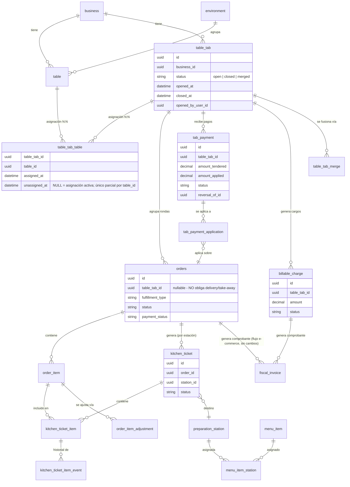
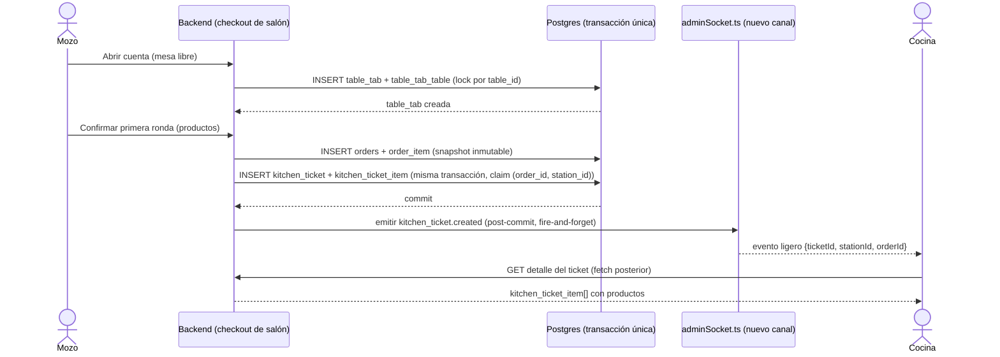
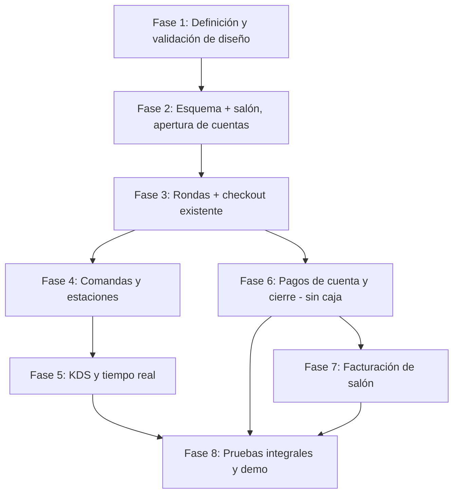

# POS_TECHNICAL_DESIGN — Diseño técnico consolidado del POS de salón de Gesty

> Documento de síntesis y diseño. No modifica código, schema, migraciones, servicios, rutas, sockets, frontend ni tests. No instala dependencias ni crea prototipos. Es la referencia técnica para implementar el POS de salón por fases sin tener que reconstruir las decisiones de las auditorías previas.
>
> **Clasificación usada en todo el documento** (obligatoria, no intercambiable):
> - **HECHO** — comportamiento o infraestructura confirmados en el repositorio actual, con cita `archivo:línea`.
> - **DECISIÓN APROBADA** — definición funcional/arquitectónica ya aceptada por el usuario (ver §3). No se reabre.
> - **PROPUESTA TÉCNICA** — solución recomendada derivada de las auditorías, que todavía requiere aprobación explícita.
> - **PENDIENTE** — decisión funcional, comercial o técnica sin definir.
>
> Una recomendación de auditoría **no se convierte automáticamente en decisión aprobada** solo por aparecer aquí. Donde una propuesta coincide con una decisión ya aprobada por el usuario, se marca como tal explícitamente.

---

## 0. Documentos y módulos consultados

| Documento | Estado | Uso en este documento |
|---|---|---|
| `docs/arquitectura/POS_MASTER_SPEC.md` | Presente (no versionado en git aún — archivo untracked) | Fuente primaria de las Auditorías A (núcleo comercial) y B (salón/mesas/reservas), y de un primer boceto de C (cocina). Leído completo. |
| `docs/arquitectura/KITCHEN_AUDIT.md` | Presente, recién generado | Fuente primaria de la Auditoría C en profundidad (cocina/comandas/concurrencia/roles/KDS). Leído completo. |
| `docs/arquitectura/SABROSON_POS_AUDIT.md` | Presente, recién generado | Fuente de datos reales del negocio de pruebas (Sabrosón) y de riesgos de aislamiento (pagos/facturación). Leído completo. |
| Informes "originales" de las Auditorías A y B como documentos independientes | **No encontrados como archivos separados** | `POS_MASTER_SPEC.md` declara explícitamente en su encabezado que "consolida las Auditorías A... B... C", es decir, es la única fuente escrita de A y B disponible en el repo — no existen `AUDITORIA_A.md`/`AUDITORIA_B.md` ni equivalentes en `docs/arquitectura/`. Se documenta esta ausencia conforme a la instrucción de no asumir ni inventar su contenido: todo lo atribuido aquí a "Auditoría A" o "Auditoría B" proviene de `POS_MASTER_SPEC.md`, no de un informe independiente verificado por separado. |
| Resto de `docs/arquitectura/*.md` (ciclo de vida de estado operativo, taxonomía, violaciones, roadmap) | Presentes, no relacionados directamente con el POS de salón | No se usaron — fuera de alcance temático. |
| `prisma/schema.prisma` | Código real | Verificado directamente (ver §1) para confirmar que no hubo cambios posteriores a las auditorías: `table_tab`, `kitchen_ticket`, `preparation_station`, `orders.table_tab_id` **siguen sin existir**. |
| `src/socket/adminSocket.ts` | Código real | Verificado directamente: `ADMIN_NOTIFICATION_ROLES = Set(["OWNER","ADMIN"])` (línea 35) **sigue vigente**, sin cambios desde la Auditoría C. |
| `git log` (15 commits más recientes de la rama `intent_lifecicle_poc`) | Verificado | Ninguno de los commits recientes toca mesas, cuentas, cocina o comandas — los últimos cambios son sobre facturación (CUIT, Sistemas 360), permisos de reservas y listado de facturas. No hay drift relevante respecto a lo auditado. |

No se consultaron: los repos `gesty-admin` fuera de lo ya citado en `KITCHEN_AUDIT.md`, ni ningún sistema externo (Mercado Pago, Sistemas 360) más allá de su configuración ya documentada.

---

## 1. Estado actual auditado (resumen, con remisión a la fuente)

> Esta sección no repite íntegramente las auditorías — las resume y cita, remitiendo al documento original para el detalle línea por línea.

### 1.1 Núcleo comercial (Auditoría A, vía `POS_MASTER_SPEC.md §2`)
- **HECHO** `orders`/`order_item`: pedido confirmado, inmutable desde `placed`. Cero `update`/`delete`/`upsert` sobre `order_item` fuera de su creación (`checkout.service.ts`, confirmado también de forma independiente en `KITCHEN_AUDIT.md §2`).
- **HECHO** `payment_intent`: pago único online (Mercado Pago), `status` string libre, XOR con `draft_order_id`/`order_id` (`prisma/schema.prisma:871-897`). No admite pagos parciales ni múltiples medios.
- **HECHO** `payment_proof`: comprobante de transferencia, exige coincidencia **exacta** con `total_amount` (`paymentProofChecks.ts:44-51,119`). No sirve para "cobré parte de la cuenta".
- **HECHO** `fiscal_invoice`: 1:1 por pedido, idempotencia vía `idempotencyKey = businessId:orderId:kind` (`invoice.service.ts:52-54`). `credit_note` existe en el enum `FiscalInvoiceKind` pero **sin servicio emisor** (grep sin resultados).
- **HECHO** Patrón de idempotencia real y probado: `pg_advisory_xact_lock` en `acquireOrderCreateLock` (`checkout.service.ts:85-100`), y claim transaccional `claimInvoiceRow`/`decideFromExisting` (`invoice.service.ts:112-215`). Antipatrón conocido: `handleDraftOrder` (`order.service.ts:399-426`) sin lock, condición de carrera real ya documentada, no corregida.
- **HECHO** `getNextOrderStatus()` (`orderWorkflow.ts:58-74`) existe pero **nunca se invoca** en el único PATCH de estado (`adminOrders.routes.ts:226`) — sin enforcement real de la máquina de estados de orden.

### 1.2 Salón, mesas y reservas (Auditoría B, vía `POS_MASTER_SPEC.md §2` y `SABROSON_POS_AUDIT.md §3/§6`)
- **HECHO** `table`/`environment`: recurso físico con layout (`x,y,shape,width,height,rotation`, `capacity`), **sin campo de estado de ocupación** (`prisma/schema.prisma:592-605,660-682`).
- **HECHO** `reservation`/`reservation_table`/`reservation_block`: expectativa futura de visita. `reservation_table` ya es N:N reserva↔mesa. No equivale a "mesa ocupada ahora" — el check-in (`checkin.service.ts`) solo cierra el registro de reserva, no libera nada físico porque la mesa no tiene estado que liberar.
- **HECHO** `orders` no tiene `table_id` ni ninguna FK a `table`/`environment` (confirmado contra `information_schema.columns` real en `SABROSON_POS_AUDIT.md`, no solo contra el schema declarado).
- **HECHO** `FulfillmentType` solo tiene `DELIVERY`/`TAKE_AWAY` (`prisma/schema.prisma ~1024-1027`). Al menos 6 archivos tienen defaults binarios no exhaustivos sobre este enum (`storefrontOrderPush.service.ts`, `publicOrders.service.ts`, `adminOrders.service.ts:117`, entre otros) que requieren auditoría manual antes de agregar `DINE_IN`.
- **HECHO** (Sabrosón, datos reales) 2 ambientes, 11 mesas con nombres duplicados y una "mesa de prueba" — datos de seed sin limpiar, no un layout curado.

### 1.3 Cocina y comandas (Auditoría C, `KITCHEN_AUDIT.md`)
- **HECHO** Cero infraestructura de cocina en backend ni en `gesty-admin` (grep exhaustivo sin resultados). Sin dependencias de impresión térmica en ningún `package.json`.
- **HECHO — hallazgo crítico para el diseño de roles/tiempo real** `ADMIN_NOTIFICATION_ROLES = Set(["OWNER","ADMIN"])` (`adminSocket.ts:35`); cualquier otro rol se desconecta inmediatamente al conectar (`:147-153`). Verificado vigente hoy (§0).
- **HECHO** `admin:order`/`admin:reservation`: payloads reales sin líneas de producto, sala única `admin:<businessId>` sin granularidad de estación.
- **HECHO** `OrderStatus.preparing`/`ready_for_pickup` son estados de **pedido completo** del flujo delivery/take-away, nunca por producto — confirmado con evidencia directa de esquema y código, no solo por inferencia.
- **PENDIENTE (no resuelto por ninguna auditoría)** Un producto que requiere preparación coordinada en dos estaciones físicas no tiene solución limpia con el modelo `menu_item_station` N:N simple.

### 1.4 Configuración y riesgos del negocio de pruebas (Sabrosón, `SABROSON_POS_AUDIT.md`)
- **HECHO** `business_id = e89dfb88-a409-4818-a01e-37d7d5ba2e11`, activo, con datos reales de uso (42 pedidos, 10 reservas, 4 usuarios con 138 sesiones históricas).
- **DISCREPANCIA DE CONFIGURACIÓN, verificación pendiente antes de pruebas de pago** `business_payment_provider` de Sabrosón tiene el flag `is_sandbox: false`, pero el usuario confirmó que Sabrosón es un negocio ficticio de pruebas y que las credenciales de Mercado Pago asociadas son credenciales de prueba, no productivas. El flag es, por tanto, una discrepancia entre el indicador almacenado y el tipo real de credencial — **no es evidencia de que existan credenciales productivas ni de que una prueba genere un cobro real**. Antes de ejercitar cualquier flujo de pago de cuenta sobre Sabrosón, debe verificarse explícitamente el tipo real de credencial configurada y el comportamiento efectivo de la integración (no inferirlo del flag). El lado fiscal (Sistemas 360) está confirmado en sandbox por un campo propio (`external_issuer_environment`), sin esta ambigüedad.
- **HECHO** Catálogo de Sabrosón duplicado ~50% (97/201 `menu_item` con nombre repetido), con disponibilidad inconsistente entre duplicados; 25% de ítems sin precio cargado.
- **HECHO** Roles reales de Sabrosón: 1 OWNER, 1 ADMIN, 1 STAFF, 1 DELIVERY. Ningún rol de mozo/cocina/cajero.

---

## 2. Contradicciones e imprecisiones detectadas entre fuentes

Se documentan explícitamente, sin resolverlas por intuición, conforme a la instrucción de no ocultarlas:

1. **Superposición de alcance entre `POS_MASTER_SPEC.md §3.2` y `KITCHEN_AUDIT.md`**: el master spec ya bocetaba `kitchen_ticket`/`kitchen_ticket_item`/`preparation_station` como propuesta inicial; `KITCHEN_AUDIT.md` es una segunda pasada mucho más profunda sobre el mismo tema, con detalle adicional (constraint `@@unique([order_id, station_id])`, decisión síncrona vs. asíncrona, roles, KDS). **No son contradictorios** — el segundo refina al primero — pero un lector que solo lea el master spec puede quedarse con una versión incompleta. **Resolución**: este documento adopta el diseño de `KITCHEN_AUDIT.md` como la versión vigente y más detallada; el boceto del master spec queda como antecedente histórico, no como fuente de verdad paralela.
2. **Citas de rango de línea inconsistentes entre pasadas, ya señaladas en `POS_MASTER_SPEC.md §5.3`**: el advisory lock de creación de orden se citó como `checkout.service.ts:85-96` en una pasada y `85-100` en otra — mismo bloque real (`acquireOrderCreateLock`), discrepancia de rango, no de hecho. Se adopta `85-100` (más reciente) en este documento, sin re-leer línea por línea, porque no afecta ninguna conclusión aquí.
3. **Alcance de la Auditoría C citado en el master spec vs. el prompt original de la tarea de cocina**: el master spec, al momento de escribirse, atribuía a "Auditoría C" el tema cocina en su totalidad; la tarea de cocina posterior (`KITCHEN_AUDIT.md`) usó internamente una numeración propia A-J para sus propias subsecciones, no relacionada con la numeración A-F de `SABROSON_POS_AUDIT.md` ni con la A/B/C del master spec. **No es una contradicción de contenido, sino de nomenclatura** entre documentos — se señala para que un lector no confunda "Auditoría A" de un documento con la de otro. Este documento usa únicamente las letras A-F de la §4 de esta misma tarea (salón/mesas, cuentas/rondas, cocina/comandas, pagos/caja, facturación, usuarios/permisos) para evitar sumar una cuarta numeración.
4. **Ningún hallazgo sustantivo de las tres auditorías se contradice entre sí** en cuanto a qué existe o no existe en el código (todas coinciden en: sin `table_id` en `orders`, sin estado de ocupación de mesa, sin cocina, sin roles de mozo/cocina/cajero). La única fuente de fricción es de encuadre/numeración, no de evidencia.

---

## 3. Decisiones ya aprobadas (no se reabren)

Transcritas literalmente del encargo del usuario, sin reinterpretación:

1. El primer alcance del POS es **salón**. Mostrador queda fuera de esta primera fase.
2. La cuenta de consumo se modela conceptualmente mediante `table_tab`, opción elegida frente a vincular directamente cada pedido a una mesa (Opción 1, descartada) o mutar una orden para convertirla en cuenta abierta (Opción 3, descartada) — descartes ya registrados en `POS_MASTER_SPEC.md §3` y no reabiertos aquí.
3. Las órdenes y sus ítems conservan sus snapshots comerciales. No se reescriben rondas anteriores.
4. Una cuenta puede agrupar varias órdenes/rondas.
5. Las mesas pueden agruparse o transferirse sin reasignar ni alterar el historial económico.
6. Los pagos de salón requieren un ledger propio, con soporte para pagos parciales, aplicaciones y reversos.
7. La facturación debe contemplar cargos económicos (`billable_charge`) que puedan consolidar consumos de varias rondas.
8. Cocina necesita un subsistema independiente de los estados comerciales actuales de `OrderStatus`.
9. Para la primera fase, routing simple de productos a estaciones (1 estación por `menu_item`). Los platos multi-estación quedan fuera del MVP.
10. La impresión térmica no es bloqueante para la primera versión. Se prioriza un KDS web.
11. Sabrosón es el negocio ficticio de referencia. No se duplica ni se crea otro negocio.

Todo lo que sigue en este documento respeta estas once decisiones sin excepción. Donde una auditoría previa haya sugerido una alternativa descartada (p. ej. vincular pedido↔mesa directamente), se señala como opción ya cerrada, no como propuesta viva.

---

## 4. Arquitectura propuesta

### 4.A Salón y mesas

**Estado actual** — HECHO: `table` sin campo de ocupación; `reservation*` gestiona solo expectativa futura, no presencia física.

**PROPUESTA TÉCNICA — estado operativo de mesa**: derivado, no un campo mutado de forma independiente. Una mesa está `ocupada` si y solo si existe una fila **activa** en `table_tab_table` que la referencia (ver corrección de unicidad abajo) cuya `table_tab` asociada tiene `status = open`; está `libre` en caso contrario (sin importar si tiene una reserva futura, que es un concepto distinto). Esto evita el riesgo de "estados contradictorios entre mesa y cuenta" (§5): no hay dos fuentes de verdad que puedan desincronizarse, porque solo hay una (la asignación activa + el estado de la cuenta que referencia).

**PROPUESTA TÉCNICA — apertura de cuenta y unicidad de asignación activa (corregido)**: crear `table_tab{status: open}` + `table_tab_table{table_tab_id, table_id, assigned_at, unassigned_at}` dentro de una transacción protegida por `pg_advisory_xact_lock` keyed por `(business_id, table_id)` — por analogía directa con `acquireOrderCreateLock`.

El invariante que debe protegerse **no** es "una sola `table_tab` con `status = open`" (eso, por sí solo, no impide que la misma mesa termine con asignaciones activas a dos cuentas abiertas distintas, cada una con su propia fila de `table_tab_table`), sino **la unicidad de la asignación activa por mesa**: a lo sumo una fila de `table_tab_table` con `unassigned_at IS NULL` por `table_id`. Esto se garantiza con un índice único parcial real sobre `table_tab_table` (`CREATE UNIQUE INDEX ... ON table_tab_table(table_id) WHERE unassigned_at IS NULL`, no expresable en el DSL declarativo de Prisma, requiere migración SQL manual) — no delegar esta garantía solo a la capa de aplicación.

Que la cuenta referenciada esté efectivamente abierta se garantiza por construcción, no por un segundo constraint redundante: la asignación activa solo se crea en el mismo paso atómico que abre la `table_tab` (o que agrega una mesa a una ya abierta), bajo el mismo advisory lock, tras verificar en esa transacción que la `table_tab` tiene `status = open`; y se cierra (`unassigned_at = now()`) exactamente cuando la `table_tab` se cierra o cuando la mesa se transfiere/desasigna, nunca de forma independiente. La garantía dura contra doble asignación la da el índice único parcial; el chequeo de servicio solo evita crear una asignación activa contra una cuenta que ya no está abierta.

Esto preserva sin cambios las capacidades ya aprobadas: **agrupar varias mesas en una cuenta** sigue siendo posible — el índice único es por `table_id`, no por `table_tab_id`, de modo que una misma `table_tab` puede tener múltiples filas activas de `table_tab_table` (una por mesa agrupada) sin violar el constraint. **Transferir una mesa** sigue sin alterar el historial económico ni reasignar órdenes: se cierra la fila activa vieja (`unassigned_at = now()`) y se abre una fila nueva, nunca se edita la fila existente ni se reasignan las `orders` ya creadas sobre esa `table_tab`.

**PROPUESTA TÉCNICA — asignación de responsable (mozo)**: campo `table_tab.opened_by_user_id` (no nullable tras creación), más una tabla de reasignación si se permite transferir la cuenta entre mozos (`table_tab_assignment_event`, análoga al patrón de eventos ya usado en `kitchen_ticket_item_event` de `KITCHEN_AUDIT.md §6`) — **PENDIENTE** decidir si la reasignación de mozo es necesaria para el MVP o se difiere.

**DECISIÓN APROBADA, ya detallada técnicamente en `POS_MASTER_SPEC.md §3.1`**: transferencia de mesa = cerrar la fila vieja de `table_tab_table` y abrir una nueva (nunca editar la existente, para no perder trazabilidad de qué mesa ocupó la cuenta en qué momento). Unión de cuentas = `table_tab_merge{primary_tab_id, merged_tab_id}`, nunca reasignando `orders.table_tab_id` ni pagos históricos (ver ejemplo numérico en `POS_MASTER_SPEC.md §3.1.1`, no repetido aquí).

**DECISIÓN APROBADA — reasignación de mozo sin tabla de eventos (MVP)**: se difiere `table_tab_assignment_event`. `table_tab` tiene un campo simple `assigned_user_id` (por defecto, igual a `opened_by_user_id` al abrir la cuenta), actualizable mediante un PATCH directo ante cambio de turno — sin mantener un historial inmutable de quién fue responsable de la mesa en cada momento. **Impacto técnico**: el PATCH de reasignación es una escritura simple sobre `table_tab.assigned_user_id`, protegida por el mismo advisory lock de cuenta (`(business_id, table_tab_id)`) para serializarla contra un cierre/transferencia concurrente, pero sin tabla de auditoría adicional — si en el futuro se necesita ese historial, se agrega como mejora posterior, no como parte del MVP.

**DECISIÓN APROBADA — "mesa actual", sin historial versionado explotable**: no se requiere historial operativo de qué mesa ocupó la cuenta en rangos horarios anteriores para el MVP. Al transferir una cuenta de mesa, se marca `unassigned_at` de la fila vieja de `table_tab_table` y se crea la asignación nueva — el dato queda en la base (nunca se borra ni se edita la fila vieja, preservando la disciplina de inmutabilidad ya exigida en el resto del diseño), pero el sistema no construye reportes ni consultas que exploten ese historial en esta fase. **Impacto técnico**: no cambia el modelo ya propuesto de `table_tab_table` (assigned_at/unassigned_at) — la decisión es de alcance de uso, no de esquema: se implementa exactamente el modelo ya descrito arriba, simplemente sin construir, por ahora, ninguna vista de "historial de mesas de esta cuenta".

### 4.B Cuentas y rondas

**DECISIÓN APROBADA**: `table_tab` agrupa N `orders` (rondas), cada ronda es una `orders` nueva e independiente con `table_tab_id` (nullable, para no afectar delivery/take-away) seteado.

**PROPUESTA TÉCNICA — concurrencia de varios mozos sobre la misma cuenta**: dos mozos agregando rondas a la misma `table_tab` simultáneamente no colisionan a nivel de datos porque cada ronda es una fila `orders` nueva e independiente (no hay UPDATE compartido). El riesgo real no es de escritura concurrente sobre la cuenta, sino de **generación duplicada de comandas** si el mismo mozo reintenta la misma ronda — resuelto en 4.C con el mismo patrón de claim ya usado en facturación. Para operaciones que sí mutan la cuenta como entidad (cerrarla, fusionarla), se recomienda `pg_advisory_xact_lock` keyed por `(business_id, table_tab_id)`, por analogía con `checkout.service.ts`.

**DECISIÓN APROBADA — cierre estricto basado en invariantes contables**: el cierre de una `table_tab` se evalúa en dos niveles, no en una única regla binaria "saldo = 0":

- **Bloqueos duros (abortan el cierre, nunca se puede forzar)**:
  1. Saldo distinto de cero — deuda pendiente en cualquier orden/ronda de la cuenta (cálculo derivado vía ledger, ver §4.D, **nunca** sobre `OrderPaymentStatus` cacheado).
  2. Existencia de al menos un `tab_payment` en estado `pending` sobre la cuenta — un pago todavía no confirmado no puede considerarse parte del saldo liquidado; cerrar con un pago `pending` abierto arriesgaría cerrar una cuenta cuyo saldo real cambie después (confirmación tardía, rechazo del proveedor).
  - Ningún `billable_charge` en estado `open` (regla ya definida en `POS_MASTER_SPEC.md §3.1`) se mantiene sin cambios como tercer bloqueo duro, sin reemplazar a los dos anteriores — los tres se evalúan en conjunto.
- **Advertencias blandas (no bloquean transaccionalmente; requieren confirmación explícita del cajero para proceder)**: productos aún no despachados — `kitchen_ticket_item` en estado `pending` o `preparing` al momento del intento de cierre. El estado de cocina es informativo para esta decisión, no una condición contable: un cajero puede cerrar la cuenta con productos todavía en preparación (p. ej. el cliente pagó y se retira, o el consumo pendiente se pasa a cuenta de casa) siempre que los dos bloqueos duros anteriores no se activen. La UI debe mostrar la advertencia y exigir una confirmación explícita (no un default silencioso) antes de proceder.
- **Impacto técnico**: el servicio de cierre debe evaluar los bloqueos duros **dentro** de la misma transacción protegida por el advisory lock de cuenta ya propuesto (`pg_advisory_xact_lock` keyed por `(business_id, table_tab_id)`), releyendo saldo y estado de pagos bajo lock — nunca aceptar un cierre basado en un saldo leído antes de adquirir el lock. La verificación de advertencias blandas (estado de cocina) puede hacerse con una lectura normal (no requiere el mismo nivel de atomicidad, porque no bloquea nada por sí sola), pero debe mostrarse en la misma operación de cierre para que el cajero decida con información completa.

**PENDIENTE, no resuelto por esta decisión**: si una cuenta cerrada puede "reabrirse" (p. ej. el cliente vuelve a pedir después de haber pagado) o siempre debe abrirse una `table_tab` nueva — no resuelto por ninguna auditoría; se mantiene la recomendación, por simplicidad y por preservar el principio de inmutabilidad histórica, de que **nunca se reabra** una cuenta cerrada: cualquier consumo nuevo sobre la misma mesa abre una `table_tab` nueva. Esta recomendación es independiente de la decisión de cierre estricto recién aprobada y sigue requiriendo aprobación explícita propia.

### 4.C Cocina y comandas

Se adopta íntegramente el diseño de `KITCHEN_AUDIT.md §13`, con los puntos que el encargo de esta tarea señala explícitamente como críticos:

- **HECHO, verificado vigente hoy (§0)**: `ADMIN_NOTIFICATION_ROLES` limita las notificaciones a `OWNER`/`ADMIN`. **PROPUESTA TÉCNICA**: crear un set paralelo `KITCHEN_NOTIFICATION_ROLES` (o extender el existente de forma explícita) antes de implementar cualquier evento de cocina — de lo contrario, los roles nuevos de mozo/cocina quedarán desconectados del tiempo real por un detalle de autorización ya identificado, no por falta de diseño.
- **DECISIÓN APROBADA**: routing simple (1 estación por `menu_item`); platos multi-estación fuera del MVP — la brecha de modelo señalada en `KITCHEN_AUDIT.md §5` (sin solución limpia con `menu_item_station` N:N simple) queda **explícitamente diferida**, no resuelta ni bloqueante para el MVP, por esta misma decisión ya aprobada.
- **PROPUESTA TÉCNICA, con precedente directo en el repo**: la generación de `kitchen_ticket`/`kitchen_ticket_item` ocurre **en la misma transacción** que confirma la orden/ronda de salón — nunca fire-and-forget como la facturación. La idempotencia se garantiza con `@@unique([order_id, station_id])` sobre `kitchen_ticket`, mismo patrón de claim que `claimInvoiceRow`/`decideFromExisting`.
- **Restricción de idempotencia y rondas legítimas** (punto explícitamente señalado por el encargo de esta tarea): el constraint `@@unique([order_id, station_id])` opera sobre `order_id`, **no** sobre `table_tab_id` ni sobre la mesa. Esto es deliberado: una segunda ronda de la misma cuenta es una `orders` nueva con su propio `id`, por lo que genera sus propios `kitchen_ticket` legítimamente, sin chocar con el constraint de la ronda anterior. El constraint solo bloquea el **reintento de la misma ronda** (mismo `order_id`), nunca una ronda nueva. Esta distinción se marca explícitamente porque un diseño ingenuo que usara `(table_id, station_id)` como clave rompería exactamente la invariante de "nuevas rondas legítimas no deben bloquearse" que pide el encargo (ver también §5).
- **Publicación de eventos después del commit**: la notificación de socket (`kitchen_ticket.created`, `kitchen_ticket_item.status_changed`) es **asíncrona post-commit** — la persistencia es la fuente de verdad, el evento es solo aviso. **Estrategia de recuperación ante reconexión**: dado que el cliente (KDS) no tiene hoy ningún mecanismo de resync (confirmado en `KITCHEN_AUDIT.md §3/§8`), debe implementarse un refetch REST completo al conectar/reconectar (`GET /api/admin/kitchen/tickets?station=...&status=open`), no confiar en que el socket "rellene" lo perdido.
- **Fiabilidad de eventos más allá de la reconexión (corrección)**: el refetch al reconectar cubre la desconexión visible, pero **no cubre que un evento se pierda mientras el cliente permanece conectado** (p. ej. error transitorio al emitir). La persistencia de `kitchen_ticket`/`kitchen_ticket_item` es la única fuente de verdad; Socket.IO es exclusivamente un mecanismo de notificación de baja latencia, nunca de persistencia — el KDS debe poder recuperar el estado real de sus tickets incluso si nunca perdió la conexión pero sí perdió un evento puntual. **PROPUESTA TÉCNICA, ninguna alternativa aprobada aún**:
  1. **Outbox transaccional**: tabla `kitchen_event_outbox` donde cada cambio se inserta en la misma transacción que lo origina, y un publicador separado lo emite y lo marca como `published`. Ningún evento se pierde en el origen (sobrevive a una caída del proceso justo después del commit), a costa de una pieza de infraestructura nueva (el publicador) y de latencia adicional entre commit y notificación.
  2. **Reconciliación periódica vía REST**: el KDS hace un refetch completo de tickets abiertos cada N segundos (p. ej. 10-15s), independientemente de si perdió o no la conexión, como red de seguridad adicional a los eventos de socket. Más simple (ninguna tabla nueva), pero deja una ventana de hasta N segundos sin reflejar un evento perdido.
  3. **Combinación de ambas**: socket para actualización inmediata, reconciliación periódica de baja frecuencia (p. ej. 30-60s) como red de seguridad, y outbox solo si la reconciliación periódica demuestra no ser suficiente en la práctica.
  - **RECOMENDACIÓN, no decisión aprobada**: comenzar con la alternativa 2 para el MVP, por simplicidad, y dejar el outbox (alternativa 1) como mejora posterior si la frecuencia real de eventos perdidos lo justifica. **Debe quedar explícito que la recuperación de estado del KDS no puede depender exclusivamente de la reconexión del socket** — el polling periódico opera sin importar si la conexión se cayó o no.
- **Entregas parciales y cancelaciones, nuevas rondas sin duplicar**: ver el detalle completo ya desarrollado en `KITCHEN_AUDIT.md §6/§7` (estados derivados, tres mecanismos de modificación según tipo de cambio, nunca UPDATE in place) — no se repite aquí, se adopta sin cambios.
- **DECISIÓN APROBADA — anulación de productos y su impacto económico**: se permite anular un producto ya confirmado (baja de `amount_due` de la orden, vía el mecanismo de anulación compensatoria `order_item_adjustment` ya propuesto, nunca editando `order_item`), pero con dos caminos distintos según el estado del `kitchen_ticket_item` en el momento de la anulación:
  - Si el ítem está en `pending` (cocina todavía no empezó a prepararlo): anulación **sin fricción**, sin exigir motivo — el costo operativo de la anulación es nulo (nada se desperdició).
  - Si el ítem está en `preparing` o `ready`: la anulación **exige obligatoriamente** un flujo de registro de motivo (`cancel_reason` estructurado, p. ej. `out_of_stock | customer_request | kitchen_error | ...`, más el usuario que la solicita) antes de poder completarse — nunca una anulación silenciosa, porque en este punto ya hubo preparación (mano de obra, posible merma de insumos) que debe quedar auditada. Esto resuelve, en su componente de **cuándo** se exige el motivo, el punto 1 de §9/`KITCHEN_AUDIT.md §15` ("quién autoriza la cancelación de un producto después de iniciada su preparación"). **PENDIENTE, no resuelto por esta decisión**: qué rol concreto (`MOZO`, `COCINA`, `OWNER`/`ADMIN`) puede *ejecutar* la anulación en cada uno de los dos casos — la decisión aprobada fija la condición que dispara la exigencia de motivo, no la matriz de permisos por rol, que sigue dependiendo de que los roles de §4.F se aprueben.
  - **Impacto técnico**: el servicio de anulación debe leer el `kitchen_ticket_item.status` vigente **dentro de la misma transacción** (compare-and-swap, ya exigido en `KITCHEN_AUDIT.md §10` para evitar condición de carrera con una transición de cocina concurrente) antes de decidir si exige motivo o no — nunca inferirlo de un estado leído previamente fuera de la transacción. El `order_item_adjustment` resultante debe registrar, además del motivo, una referencia al `kitchen_ticket_item_event` que disparó la condición (estado al momento de la anulación), para que el ledger de ajustes y el de cocina queden reconciliados por construcción y no por sincronización manual — brecha que `KITCHEN_AUDIT.md §14` había dejado explícitamente pendiente.

### 4.D Pagos y caja

**DECISIÓN APROBADA**: ledger propio (`tab_payment`/`tab_payment_application`), con pagos parciales, aplicaciones y reversos.

- **PROPUESTA TÉCNICA, ya detallada en `POS_MASTER_SPEC.md §3.3`**, adoptada sin cambios:
  - `tab_payment{amount_tendered, amount_applied, status, reversal_of_id, idempotency_key}` — `amount_tendered` es lo que efectivamente entró, `amount_applied` lo aplicado a deuda real (`<= tendered`); la diferencia es el **vuelto**, dato que solo interesa a caja física y nunca contamina el saldo de cuenta.
  - `tab_payment_application{tab_payment_id, order_id, amount}` — reparto de un pago entre las órdenes con saldo pendiente de la cuenta.
  - **DECISIÓN APROBADA — reparto de pagos parciales**: el reparto por defecto entre las órdenes con saldo pendiente de la cuenta es **FIFO** (se cubre primero la ronda más antigua con saldo pendiente) — se descarta explícitamente el modelo proporcional, por la complejidad fiscal que introduciría (prorratear impuestos/IVA entre rondas de distinto momento, con sus propios snapshots de `order_item`, sin un caso de negocio que lo justifique). El sistema debe admitir además una **asignación explícita** por parte del cajero (p. ej. "yo pago mi postre", split por comensal) que sobreescribe el reparto automático para ese cobro puntual — el reparto FIFO es el comportamiento sin intervención, no el único camino posible. **Impacto técnico**: el servicio de aplicación de pago necesita dos modos de entrada — (a) monto total + reparto automático FIFO calculado en servicio, (b) lista explícita de `{order_id, amount}` provista por el cajero, validada contra el saldo pendiente real de cada orden en la misma transacción (bajo el mismo lock de cuenta ya propuesto en §4.B) — nunca confiar en un reparto calculado en el cliente sin revalidar servidor-side.
  - **Reversos**: fila nueva con `reversal_of_id` y signo contrario — nunca UPDATE/DELETE de una fila `confirmed`. Esto es la instancia concreta de la invariante "los pagos confirmados no se editan destructivamente" (§5).
  - **DECISIÓN APROBADA — vuelto dinámico, sin saldo a favor**: la invariante estricta es `amount_applied ≤ deuda pendiente de la cuenta en el momento de la aplicación` — nunca puede exceder la deuda real. Cualquier excedente (`amount_tendered − amount_applied`) es **vuelto a entregar**, calculado por el frontend/POS en el momento del cobro y nunca persistido como deuda negativa ni como crédito reutilizable: queda explícitamente **excluido del MVP** cualquier "saldo a favor" de cliente (cierra el punto que §2.4 de la auditoría económica dejaba abierto entre varias alternativas — se adopta aquí la más simple de las evaluadas). **Impacto técnico**: el servicio de aplicación de pago debe calcular la deuda pendiente *antes* de aceptar `amount_applied`, rechazar cualquier intento de aplicar más que esa deuda (constraint de aplicación, no solo de UI), y devolver el vuelto como dato de respuesta de la operación — nunca como una fila adicional en el ledger. Si el cliente entrega de más sin intención de llevarse vuelto (caso límite, p. ej. propina), eso se modela como un pago nuevo por el monto exacto que se decide aplicar, no como un `tab_payment` con excedente no resuelto.
  - **Fuente única de verdad económica (corregido)**: el ledger (`tab_payment`/`tab_payment_application`) es la fuente de verdad de todo lo que se cobró y aplicó, **tanto a nivel de cuenta como de cada orden/ronda dentro de ella** — no solo a nivel de cuenta. El saldo de cuenta es `Σ orders.total_amount` del conjunto transitivo de cuentas (resuelto vía `table_tab_merge`) **menos** `Σ tab_payment_application.amount` confirmadas, siempre agregación en consulta, **nunca** un campo cacheado mutado fuera de transacción. Cuánto se pagó de una orden específica dentro de la cuenta se determina del mismo modo, agregando `tab_payment_application.amount` filtrado por esa `order_id` — nunca leyendo `OrderPaymentStatus` como dato primario.
- **`OrderPaymentStatus` como proyección, no como fuente de verdad (corregido)**: `OrderPaymentStatus` (binario, existente, usado hoy por el flujo de e-commerce) **no compite con el ledger**. Para una orden que es ronda de una `table_tab`, se trata como una **proyección derivada y de solo lectura** del ledger: se recalcula (`paid` si la suma de `tab_payment_application` aplicada a esa orden cubre su `total_amount`, `unpaid` en caso contrario) cada vez que se escribe una aplicación de pago sobre esa orden — nunca al revés, el ledger nunca se infiere desde `OrderPaymentStatus`. Para el flujo de e-commerce existente (delivery/take-away, sin `table_tab`), `OrderPaymentStatus` conserva su rol actual sin cambios, porque esas órdenes nunca tienen `table_tab_id` y el ledger de salón no las toca.
- **PROPUESTA TÉCNICA — reconciliación ante discrepancias**: si `OrderPaymentStatus` de una orden de salón y la agregación del ledger llegaran a diferir (p. ej. por un bug o una escritura parcial interrumpida), **el ledger siempre gana** — un mecanismo de reconciliación debe recalcular `OrderPaymentStatus` desde `tab_payment_application` y sobrescribir el valor cacheado, nunca al revés. **PENDIENTE**: si ese mecanismo es un job periódico o un recálculo en cada lectura — no resuelto, queda para la implementación de la Fase 6.
- **Cierre de caja y conciliación**: **HECHO/PENDIENTE, explícito**: esta pieza (turnos, arqueo, ingresos/egresos no ligados a una cuenta de cliente) está **fuera de lo auditado** por A, B y C — `POS_MASTER_SPEC.md §6` la declara explícitamente como Auditoría D futura, no realizada. Este documento no inventa su diseño: se limita a declarar la dependencia (el ledger de pagos de cuenta debe poder alimentar, a futuro, un cierre de turno) sin resolverla.

### 4.E Facturación

**DECISIÓN APROBADA**: `billable_charge` como entidad intermedia que consolida consumos de varias rondas.

- **PROPUESTA TÉCNICA, ya detallada en `POS_MASTER_SPEC.md §3.4`**, adoptada sin cambios:
  - `billable_charge` entre `table_tab` y `fiscal_invoice`: snapshot de qué líneas (de una o varias órdenes), por qué monto, a qué destinatario fiscal — equivalente, para facturación, de lo que `payment_intent` es para pago.
  - `fiscal_invoice` se generaliza con `billable_charge_id` nullable, paralelo a `order_id` (ambos nunca simultáneamente nulos, requiere CHECK constraint manual análogo al ya usado en `reservation`). Segundo índice único parcial `@@unique([business_id, billable_charge_id, kind], where: billable_charge_id IS NOT NULL)`.
  - `idempotencyKey` se generaliza a `businessId:(orderId|billableChargeId):kind` — mismo contrato, no se rediseña el motor de reclamo ya existente.
- **Anulaciones y notas de crédito**: **HECHO — bloqueante ya identificado, no resuelto**: `FiscalInvoiceKind.credit_note` existe en el enum pero **sin ningún servicio que lo emita** (confirmado por grep sin resultados en `src/services/invoicing/*.ts`). Cualquier diseño de anulación post-facturación de una cuenta de salón queda bloqueado hasta que este servicio exista — no es un problema nuevo introducido por el POS de salón, es una deuda preexistente que el POS de salón simplemente hereda y expone antes.
- **PROPUESTA TÉCNICA — prevención de doble facturación parcial (no resuelto por ninguna auditoría previa)**: facturar una cuenta de forma parcial o consolidada (decisión ya aprobada) requiere saber, antes de generar un `billable_charge`, qué cantidad de cada `order_item` (o de cada cargo facturable) **ya fue facturada** en un `billable_charge` previo — de lo contrario, dos facturas parciales podrían cubrir la misma cantidad económica dos veces. `POS_MASTER_SPEC.md §3.4` define `billable_charge` como snapshot pero no especifica cómo se evita que dos snapshots se superpongan; este documento tampoco lo resuelve, lo deja explícitamente pendiente. Se recomienda (propuesta técnica, sin aprobar) una tabla de tracking de cantidad facturada por línea — p. ej. `billable_charge_line{billable_charge_id, order_item_id, quantity_billed}` — consultada por suma, nunca cacheada de forma mutable, de modo que un `billable_charge` nuevo sobre una orden ya parcialmente facturada solo pueda tomar la cantidad remanente (`order_item.quantity − Σ quantity_billed` ya confirmada). **PENDIENTE**: si una solicitud que exceda lo remanente se rechaza siempre a nivel de aplicación, o se permite facturar de más resolviéndolo después con una nota de crédito — esto último cruza con el bloqueante de `credit_note` sin servicio emisor, señalado arriba.
- **PROPUESTA TÉCNICA — verificación pendiente, no un riesgo confirmado**: `SABROSON_POS_AUDIT.md §7` registra que `business_payment_provider.is_sandbox = false` para Sabrosón, pero el usuario confirmó que las credenciales reales asociadas son de prueba (Sabrosón es un negocio ficticio) — el flag es una discrepancia de configuración, no evidencia de riesgo de cobro real (ver corrección en §1.4). Se recomienda, antes de ejercitar la Fase 6/7 de este roadmap (§7) sobre Sabrosón, verificar explícitamente el tipo real de credencial y el comportamiento efectivo de la integración de pago — no asumir ni que es segura ni que es riesgosa solo por el valor del flag.

### 4.F Usuarios, permisos y tiempo real

**HECHO**: roles actuales `SUPER_ADMIN, OWNER, ADMIN, STAFF, DELIVERY` (`src/types/auth.ts:2-8`); `STAFF`/`DELIVERY` acceden hoy por exclusión (cero `requireRoles("STAFF", ...)` en todo `src/routes/`, confirmado con grep propio en `KITCHEN_AUDIT.md §11`).

**PROPUESTA TÉCNICA — roles nuevos** (ninguno existe hoy, todos requieren aprobación explícita antes de implementarse):

| Rol | Alcance propuesto |
|---|---|
| `MOZO` | Abre/cierra cuentas, crea rondas, ve comandas de sus mesas, marca `entregado`. No cambia estado de preparación. |
| `COCINA` | Ciclo `pendiente→en_preparación→listo` de sus tickets. No ve montos ni medios de pago. |
| `CAJERO` | Ve saldo/consumo, aplica pagos, cierra cuenta. Ve montos que `COCINA` no debe ver. |

- **PENDIENTE**: si `MOZO` reemplaza a `STAFF` para ese perfil o convive como rol nuevo adicional.
- **PROPUESTA TÉCNICA — cambios requeridos en sockets**: extender/duplicar `ADMIN_NOTIFICATION_ROLES` (ver §4.C), agregar sala(s) nueva(s) por estación/rol de cocina en paralelo a `admin:<businessId>`, y actualizar los type guards del cliente (`gesty-admin/lib/types/admin-realtime.ts`) para los nuevos tipos de evento (`kitchen_ticket.*`). **No se auditó el contenido línea por línea de ese archivo** (confirmado como no verificado en `KITCHEN_AUDIT.md`, nota de alcance) — su actualización exacta queda como tarea de implementación, no de diseño.
- **Aislamiento multi-tenant**: patrón existente `tenantBusinessId(req)` (`auth.middleware.ts:47-53`), manual por query, **sin Row-Level-Security de respaldo** (riesgo estructural preexistente, agravado por cada tabla nueva de salón/cocina si no se mantiene la disciplina).
- **PROPUESTA TÉCNICA — auditoría de acciones sensibles**: hoy `orders.update` no registra autoría de quién cambió el estado desde el panel admin (`POS_MASTER_SPEC.md §6`). Para el POS de salón, se recomienda que **toda** transición de `table_tab`, `tab_payment` y `kitchen_ticket_item` quede registrada con actor+timestamp desde el primer diseño (vía las tablas de eventos ya propuestas en 4.A/4.C), para no heredar la misma laguna de auditabilidad que ya existe en `OrderStatus`.

---

## 5. Invariantes

| Invariante | Estado hoy | Cómo se garantiza en el diseño propuesto |
|---|---|---|
| Una orden histórica no cambia por nuevas rondas | **Ya garantizado** (HECHO: `order_item` inmutable) | Sin cambios — cada ronda es una `orders` nueva |
| Una ronda confirmada no genera comandas duplicadas ante reintentos | **No existe aún el mecanismo** (PROPUESTA) | `@@unique([order_id, station_id])` + generación síncrona en la misma transacción |
| Una nueva ronda puede generar nuevas comandas legítimas | **No existe aún** (PROPUESTA, con atención explícita, §4.C) | El constraint es por `order_id`, no por mesa/cuenta — una ronda nueva tiene `order_id` nuevo y nunca choca con el de la ronda anterior |
| Una cuenta no puede tener saldos incorrectos por pagos concurrentes | **No existe aún** (PROPUESTA) | Saldo siempre calculado por agregación en consulta sobre `tab_payment_application`, nunca campo cacheado mutado fuera de transacción |
| Los pagos confirmados no se editan destructivamente | **No existe aún** (PROPUESTA) | Reversos como fila nueva (`reversal_of_id`), nunca UPDATE/DELETE de una fila `confirmed` |
| Transferir una mesa no altera el historial de consumo | **Diseñado, no implementado** (DECISIÓN APROBADA, mecanismo en `POS_MASTER_SPEC.md §3.1`) | Cerrar la fila vieja de `table_tab_table` y abrir una nueva, nunca editar la existente |
| Los eventos Socket.IO no son la fuente de verdad: la persistencia sí | **Parcialmente aplicado hoy** (el patrón ya existe para `admin:order`, pero sin resync al reconectar) | Notificación siempre post-commit; cliente hace refetch REST al reconectar, nunca reconstruye solo desde eventos |
| Delivery y take-away deben seguir funcionando sin regresiones | **Riesgo real identificado, no mitigado aún** | `orders.table_tab_id` nullable (ya decidido); auditar los ~6+ archivos con default binario de `FulfillmentType` **antes** de agregar `DINE_IN` |
| Toda operación respeta el aislamiento por `business_id` | **Implementado por muestreo, sin red de seguridad a nivel de Postgres** | Mismo patrón `tenantBusinessId` extendido a cada tabla nueva; recomendado un test de aislamiento específico por tabla nueva (`table_tab`, `kitchen_ticket`, `tab_payment`) desde la primera implementación |

**No se asume que ninguna de estas invariantes está implementada hoy salvo las dos marcadas explícitamente como "Ya garantizado"/"Parcialmente aplicado".** El resto son propuestas técnicas que deben construirse.

---

## 6. Diagramas

### 6.1 Entidades (estado futuro propuesto, extendiendo el núcleo comercial existente)

> Entidades sin sombreado especial son **todas DISEÑO/PROPUESTA TÉCNICA** (no existen en el repo), salvo `business`, `table`, `environment`, `orders`, `order_item`, `menu_item`, `fiscal_invoice`, que son **HECHO** (existentes), extendidos con campos nuevos marcados explícitamente (`orders.table_tab_id`).

### 6.2 Flujo operativo — primera ronda hasta comanda en cocina

> **Nota de fiabilidad (corrección)**: el paso `Socket-->>Cocina: evento ligero` es una notificación de baja latencia, no la fuente de verdad. El KDS complementa este flujo con una reconciliación periódica vía REST (ver §4.C) para cubrir tanto una reconexión como la pérdida puntual de un evento sin desconexión — ninguno de los dos mecanismos sustituye al otro.

### 6.3 Dependencias entre fases (ver detalle en §7)

---

## 7. Estrategia de implementación por fases

> Se adopta en líneas generales el orden ya bocetado en `POS_MASTER_SPEC.md §7`, reorganizado para separar explícitamente "fundamentos" como fase 0/1 propia (el master spec la mezclaba con la Fase 0 de salón), y para intercalar KDS como fase propia (el master spec la incluía dentro de "Fase 3 — Comandas y estaciones"). Se explica el cambio en cada fase afectada.

### Fase 1 — Definición y validación de diseño (no crea tablas ni código) — **COMPLETA Y APROBADA**
> Corrección respecto a la versión anterior: esta fase exigía constraints e índices sobre tablas que todavía no se habían creado. Se corrige separando explícitamente el diseño (esta fase, sin esquema ni código) de la implementación real del esquema (Fase 2).
>
> **Cierre de fase**: los dos últimos puntos abiertos de §4.A (reasignación de mozo y historial de ocupación de mesa) quedaron resueltos como DECISIÓN APROBADA. El índice único parcial de `table_tab_table` y la convención de tablas de eventos ya estaban especificados. No queda ningún punto del diseño de `table_tab`/`table_tab_table` sin aprobación explícita — **la Fase 2 queda formalmente habilitada para empezar**.
- **Objetivo**: cerrar, en documento, el catálogo completo de invariantes, constraints (incluido el índice único parcial corregido de `table_tab_table`, §4.A), convenciones de tablas de eventos (`*_event`, §4.A/§4.C) y decisiones de qué queda como migración SQL manual vs. declarativo Prisma — **antes** de escribir cualquier migración o servicio. Esta fase no crea tablas, no escribe migraciones, no modifica código.
- **Modelos/módulos afectados**: ninguno todavía — el único entregable es el diseño cerrado (este documento y los anexos técnicos que de él se desprendan).
- **Dependencias previas**: ninguna.
- **Riesgos**: tratar esta fase como un paso formal sin sustancia y pasar directamente a migrar sin haber cerrado las decisiones pendientes de §9 — varias de ellas (reapertura de cuentas, FIFO vs. proporcional, cancelación post-preparación, tracking de facturación) afectan directamente el diseño de las tablas que crea la Fase 2 y las siguientes; resolverlas después de migrar obliga a migrar de nuevo.
- **Pruebas necesarias**: ninguna (no hay código todavía).
- **Criterio de aceptación**: el diseño de cada tabla/constraint que la Fase 2 va a crear está completamente especificado y aprobado por el usuario, incluyendo el índice único parcial de `table_tab_table` (§4.A) y la convención de tablas de eventos.

### Fase 2 — Implementación de esquema y constraints fundamentales + operación de salón — **EN CURSO**
> La implementación real del esquema (migraciones, constraints) se ejecuta aquí, no en la Fase 1 — ver corrección arriba.
>
> **Estado de avance**: modelos `table_tab`/`table_tab_table` agregados a `prisma/schema.prisma` (enum `TableTabStatus`), migración SQL manual en `prisma/migrations/20261109120000_add_table_tab/migration.sql` (incluye el índice único parcial `unique_table_tab_table_active_assignment`) **aplicada y verificada contra la base de desarrollo** (Neon `ep-red-credit-a43tq2vb`, confirmada en `SABROSON_POS_AUDIT.md §0` y resuelta como la fuente real vía `.env.development`/`src/config/loadEnv.ts` — nunca vía `.env`). Servicios (`src/services/adminTableTab.service.ts`), controller (`src/controllers/adminTableTab.controller.ts`) y rutas (`/api/admin/table-tabs*`, en `adminOrders.routes.ts`) escritos para apertura, agrupación de mesas, transferencia, reasignación de mozo y cierre físico, con `pg_advisory_xact_lock` por mesa/cuenta, siguiendo el patrón de `acquireOrderCreateLock`. `npx prisma generate` y `npx tsc --noEmit` corren sin errores.
>
> **Decisiones operativas resueltas en paralelo**: este repositorio es ahora la única fuente de verdad del esquema (`prisma:sync` eliminado de `package.json`, ya no se sincroniza desde `food-service-backend` — **pendiente de revisión**: `DEPLOY.md §("Migraciones al arrancar"/§8/§7.2)` y `README.md` todavía documentan el flujo viejo, no se tocaron en esta entrega por quedar fuera del alcance de los cuatro dominios de esta sección). `.env` quedó con ambas `DATABASE_URL` comentadas (ninguna era identificable de forma inequívoca como "local": una es la infraestructura que reemplaza a Neon en el VPS de producción/staging, la otra un proyecto Neon sin verificar) — el flujo real de desarrollo depende exclusivamente de `.env.development`.
>
> **Pruebas de integración**: escritas en `src/services/__tests__/adminTableTab.postgres.integration.test.ts`, siguiendo exactamente el patrón ya establecido en `checkoutAttempt.postgres.integration.test.ts` (`describe.skipIf`, esquema mínimo autocontenido, dos `pg.Pool` independientes, nunca contra la base de desarrollo porque el test hace `DROP TABLE`). Cubren: dos conexiones abriendo cuenta sobre la misma mesa (solo una activa), dos mesas distintas sin bloquearse entre sí, el índice único parcial como garantía de respaldo si se pierde la exclusión de aplicación, transferencia (cierra la fila vieja sin editarla, libera la mesa origen) y cierre físico (libera todas las mesas agrupadas). **No se ejecutaron** contra una base real: este entorno no tiene acceso a Docker (`permission denied` en el socket) ni a un binario de Postgres local para levantar la base descartable que el test exige — quedan listas para correrse con `TABLE_TAB_TEST_DATABASE_URL` apuntando a un Postgres descartable (p. ej. `docker compose -f docker-compose.postgres.yml up -d`) en un entorno con esos permisos.
>
> **Pendiente de esta fase**: ejecutar las pruebas de integración recién escritas contra una base descartable real, y exponer la ocupación en el floor-plan admin existente (`gesty-admin`) — el backend ya expone `GET /api/admin/table-tabs/occupied-tables`, el consumo del lado del panel admin no se tocó (fuera del alcance de este repo).
- **Objetivo funcional**: saber si una mesa está libre/ocupada y poder abrir una cuenta sobre ella, con el esquema real ya migrado, no solo diseñado.
- **Incorpora**: migraciones de `table_tab`, `table_tab_table` (con el índice único parcial `ON table_tab_table(table_id) WHERE unassigned_at IS NULL`, §4.A), y los servicios/endpoints de apertura, transferencia y cierre de cuenta sobre mesas.
- **Dependencias previas**: Fase 1 (diseño ya aprobado y cerrado).
- **Riesgos**: concurrencia al abrir cuenta sobre la misma mesa (mitigado con advisory lock + el índice único parcial real, no solo un chequeo de aplicación).
- **Pruebas**: abrir dos cuentas simultáneas sobre la misma mesa debe dejar exactamente una asignación activa; cerrar y reabrir debe liberar/ocupar la mesa correctamente; agrupar 2 mesas en una cuenta y transferir una de ellas no debe alterar las `orders` ya creadas — pruebas de integración contra Postgres real (no mocks), dado que el propio repo ya reconoce esta limitación hoy (`createOrderFromDraftIdempotency.test.ts`, citado en `POS_MASTER_SPEC.md §2.2`).
- **Criterio de aceptación**: puede abrirse una cuenta sobre una mesa libre, queda bloqueada para otra cuenta simultánea (constraint real de base de datos, no solo de aplicación), y puede cerrarse liberando la mesa.

### Fase 3 — Rondas y conexión con el checkout existente
- **Objetivo funcional**: que un pedido de salón sea una ronda de una cuenta, no un pedido aislado.
- **Incorpora**: `orders.table_tab_id` (nullable), `FulfillmentType.DINE_IN` (solo tras auditar los ~6+ archivos con defaults binarios ya señalados), pipeline de `OrderStatus` propio para salón (sin `shipped`).
- **Dependencias previas**: Fase 2.
- **Riesgos**: romper silenciosamente delivery/take-away si no se auditan esos archivos antes de tocar el enum.
- **Pruebas**: la suite existente de delivery/take-away debe seguir pasando sin modificación; N rondas sucesivas sobre la misma cuenta sin exigir checkout/pago individual por ronda.
- **Criterio de aceptación**: se pueden crear N rondas sucesivas sobre la misma cuenta, y el pipeline de delivery/take-away sigue pasando su suite sin cambios.

### Fase 4 — Comandas y estaciones
- **Objetivo funcional**: que cocina reciba solo los productos que le corresponden, con estado propio, sin duplicados.
- **Incorpora**: `preparation_station`, `menu_item_station` (1 estación por producto, decisión ya aprobada), `kitchen_ticket`, `kitchen_ticket_item`, `kitchen_ticket_item_event`, `order_item_adjustment`.
- **Dependencias previas**: Fase 3 (necesita rondas reales que generen comandas).
- **Riesgos**: duplicación de tickets ante reintentos (mitigado con `@@unique([order_id, station_id])`); anulación de producto ya en preparación sin autorización definida (**PENDIENTE**, ver §8).
- **Pruebas**: una ronda con productos de 2 estaciones genera 2 tickets independientes; un reintento simulado de la misma ronda no duplica ningún ticket; una segunda ronda genera tickets nuevos sin tocar los de la primera.
- **Criterio de aceptación**: igual al anterior más — cada ticket tiene su propio ciclo de estado verificable.

### Fase 5 — KDS y tiempo real
> **Cambio de orden respecto al master spec**: el master spec incluía esto dentro de la misma "Fase 3 — Comandas y estaciones"; aquí se separa porque `KITCHEN_AUDIT.md §9` identificó que el KDS depende de una pieza adicional no trivial (refetch-on-reconnect, `KITCHEN_NOTIFICATION_ROLES` nuevo) que amerita su propio criterio de aceptación y no debe asumirse "incluida gratis" junto con el modelo de datos.
- **Objetivo funcional**: cocina visualiza y actualiza comandas en tiempo real, sin perder estado ante desconexiones.
- **Incorpora**: extensión de `adminSocket.ts` (o canal nuevo), `KITCHEN_NOTIFICATION_ROLES`, endpoint REST de snapshot, pantalla KDS web en `gesty-admin`.
- **Dependencias previas**: Fase 4.
- **Riesgos**: construir el KDS "solo-socket" sin refetch — deja a cocina ciega tras una desconexión breve (riesgo ya señalado explícitamente en `KITCHEN_AUDIT.md §12`).
- **Pruebas**: simular desconexión/reconexión del KDS durante una ronda en curso y verificar que el refetch recupera el estado real sin duplicar ni perder tickets.
- **Criterio de aceptación**: una pantalla de cocina que se desconecta y reconecta muestra exactamente el estado real de sus comandas abiertas, sin intervención manual.

### Fase 6 — Pagos de cuenta y cierre (sin caja operativa)
> Corrección de nombre y alcance: la versión anterior llamaba a esta fase "pagos, caja y cierre", lo cual sugiere una funcionalidad de caja completa que **no está cubierta** por las Auditorías A/B/C ni por este documento (ver §4.D). Se renombra y se delimita explícitamente.

**Incluido en el alcance de esta fase:**
- Ledger de pagos de la cuenta (`tab_payment`/`tab_payment_application`).
- Aplicación de pagos a consumos/órdenes dentro de la cuenta.
- Pagos parciales, combinados y totales.
- Reversos y compensaciones.
- Cálculo de saldo pendiente (derivado, nunca cacheado — §4.D).
- Cierre de la cuenta y liberación de la mesa, según las reglas ya aprobadas (§4.A/§4.B).

**Fuera del alcance de esta fase, pendiente de una auditoría específica (Auditoría D del master spec, no realizada):**
- Apertura y cierre de turnos de caja.
- Arqueos.
- Ingresos y egresos manuales no ligados a una cuenta de cliente.
- Gestión integral de cajeros (más allá del rol `CAJERO` propuesto en §4.F para operar el cobro de una cuenta).
- Conciliación de caja física.
- Reportes de caja y diferencias.

- **Objetivo funcional**: cobrar una cuenta con pagos parciales, combinados o divididos, con reparto FIFO por defecto y asignación explícita cuando el cajero la indique, y cerrarla bajo las reglas de cierre estricto ya aprobadas (§4.B) — **no** gestionar un turno de caja completo.
- **Incorpora**: `tab_payment`, `tab_payment_application` (con los dos modos de reparto — FIFO automático y asignación explícita, §4.D), cálculo de saldo derivado, invariante de vuelto dinámico sin saldo a favor (§4.D), evaluación de bloqueos duros/advertencias blandas de cierre (§4.B), reconciliación `OrderPaymentStatus` ↔ ledger (§4.D).
- **Dependencias previas**: Fase 3 (necesita rondas/órdenes reales).
- **Riesgos**: doble conteo si el saldo derivado se desincroniza de `OrderPaymentStatus` por orden (mitigado por la reconciliación de §4.D); reversos mal modelados rompiendo la inmutabilidad de pagos confirmados; reparto FIFO calculado sin relectura bajo lock que permita que una aplicación exceda la deuda real de una orden puntual (mitigado por la validación servidor-side exigida en §4.D); cierre que no releé saldo/pagos `pending` bajo el mismo lock de cuenta, dejando pasar un cierre sobre datos obsoletos (mitigado por la transacción de cierre descrita en §4.B).
- **Pruebas**: una cuenta con 2 rondas recibe 2 pagos parciales de medios distintos y cierra con saldo exactamente 0; un reverso de un pago mal cobrado no edita la fila original; forzar una discrepancia entre `OrderPaymentStatus` y el ledger y verificar que la reconciliación la corrige en el sentido correcto (el ledger gana); un pago que excede la deuda pendiente de la cuenta nunca persiste `amount_applied` por encima de esa deuda, y el excedente se devuelve como vuelto calculado, nunca como fila de crédito; una asignación explícita del cajero sobre órdenes puntuales se valida contra el saldo real de cada orden, no solo contra el saldo total de la cuenta; un intento de cierre con un `tab_payment` en `pending` se rechaza; un intento de cierre con productos en `pending`/`preparing` en cocina pero saldo en cero y sin pagos `pending` se permite solo tras una confirmación explícita registrada.
- **Criterio de aceptación**: igual a las pruebas anteriores, verificado contra el ejemplo numérico de `POS_MASTER_SPEC.md §3.1.1`. **No** forma parte del criterio de aceptación ningún flujo de turno de caja, arqueo o conciliación física — queda fuera de esta fase.

### Fase 7 — Facturación del consumo de salón
- **Objetivo funcional**: facturar una cuenta de salón (parcial o consolidada) sin romper la facturación de e-commerce existente.
- **Incorpora**: `billable_charge`, extensión de `fiscal_invoice` (`billable_charge_id` nullable + segundo índice único parcial), generalización de `idempotencyKey`.
- **Dependencias previas**: Fase 6 (necesita saldo/pagos reales para saber qué facturar y por qué monto).
- **Riesgos**: doble facturación si no se preserva la unicidad del `idempotencyKey` **y** si no existe, diseñado y aprobado antes de esta fase, el mecanismo de tracking de cantidad ya facturada por línea (§4.E, PENDIENTE); notas de crédito sin servicio emisor real (bloqueante ya identificado en §4.E, no resuelto por esta fase).
- **Pruebas**: una cuenta con 3 rondas se factura en un único comprobante consolidado, o en dos comprobantes parciales para destinatarios fiscales distintos, sin violar ningún `@@unique`.
- **Criterio de aceptación**: igual a lo anterior, y la suite de facturación de e-commerce existente sigue pasando sin cambios.

### Fase 8 — Pruebas integrales y preparación de demo
- **Objetivo**: validar el recorrido completo (§8) sobre Sabrosón, con los riesgos de aislamiento ya resueltos.
- **Incorpora**: limpieza previa de datos de seed de Sabrosón (mesas duplicadas, catálogo duplicado — fuera del alcance de implementación de código, es tarea de datos) y resolución del modo sandbox de pagos.
- **Dependencias previas**: Fases 5, 6 y 7.
- **Riesgos**: ejecutar la demo de pagos sobre Sabrosón sin haber verificado antes el tipo real de credencial de Mercado Pago (discrepancia de configuración señalada en `SABROSON_POS_AUDIT.md`/§1.4, no un riesgo confirmado, pero pendiente de verificación).
- **Pruebas**: recorrido completo end-to-end del MVP (§8) en un ambiente de prueba, incluyendo al menos un escenario de reintento/reconexión en cada subsistema (cuentas, comandas, pagos).
- **Criterio de aceptación**: los 10 pasos de §8 se ejecutan sin intervención manual fuera de lo esperado, y ningún paso dispara un efecto externo real no deseado (cobro real, comprobante fiscal real).

---

## 8. MVP demostrable en Sabrosón

| # | Paso | Requiere desarrollo | Reutiliza capacidad existente |
|---|---|---|---|
| 1 | Admin visualiza el salón | No (ya disponible) | `adminTables.service.ts` (floor-plan admin) |
| 2 | Mozo abre una cuenta en una mesa libre | Sí — Fase 2 completa | Patrón de advisory lock de `checkout.service.ts` |
| 3 | Mozo registra la primera ronda | Sí — Fase 3 (`table_tab_id`, pipeline de salón) | Motor de carrito/checkout/pricing existente (`cart.service.ts`, `checkout.service.ts`) |
| 4 | Cocina recibe las comandas correspondientes | Sí — Fase 4 completa | Patrón de claim idempotente de `invoice.service.ts` |
| 5 | Cocina actualiza el estado de los productos | Sí — Fase 4 (`kitchen_ticket_item.status`) + Fase 5 (notificación) | — |
| 6 | Mozo agrega una segunda ronda | Sí — ya cubierto por Fase 3 (es el caso N=2 de la misma capacidad) | — |
| 7 | Cocina recibe solamente los nuevos productos | Ya garantizado por el diseño de Fase 4 (constraint por `order_id`, no por mesa) | — |
| 8 | Caja consulta el consumo acumulado | Sí — Fase 6 (cálculo de saldo derivado) | — |
| 9 | Cliente realiza un pago parcial o total | Sí — Fase 6 completa | Infraestructura de medios de pago existente (Mercado Pago/efectivo/transferencia), **con verificación pendiente del tipo real de credencial antes de usarse (ver §4.E, §9)** |
| 10 | Se cierra la cuenta y se libera la mesa | Sí — Fase 2 (liberación derivada) + Fase 6 (regla de saldo = 0) | — |

**Pasos que NO requieren desarrollo nuevo**: solo el paso 1. Todos los demás dependen de al menos una de las Fases 2-6 — **no hay ningún atajo real para demostrar el recorrido completo sin construir el núcleo mínimo de `table_tab` + comandas + ledger de pagos.** Un recorrido parcial (p. ej. solo pasos 1-3 sin cocina ni pago) es posible antes de completar todas las fases, y se recomienda como hito intermedio de demo.

---

## 9. Riesgos y decisiones pendientes

### Riesgos técnicos
- Constraints únicos parciales (mesa↔cuenta abierta, cuenta↔cuenta fusionada) requieren migración SQL manual, no expresable en el DSL declarativo de Prisma — riesgo de implementarse mal o de omitirse "para después" (§7, Fase 1).
- El KDS depende de un mecanismo de resync que hoy no existe en ningún canal del sistema (`KITCHEN_AUDIT.md §3`) — riesgo de construirse "solo-socket" y dejar a cocina ciega ante desconexiones.
- Al menos 6+ archivos con defaults binarios sobre `FulfillmentType` deben auditarse manualmente antes de introducir `DINE_IN`, o delivery/take-away pueden romperse silenciosamente.

### Riesgos de integridad económica
- `credit_note` sin servicio emisor real — bloquea cualquier anulación post-facturación de una cuenta de salón hasta que se implemente (§4.E).
- Doble conteo de saldo si el cálculo derivado de cuenta y `OrderPaymentStatus` por orden se desincronizan — mitigable solo si el saldo siempre se calcula como función pura sobre filas, nunca campo cacheado.
- **Configuración de pagos de Sabrosón con flag `is_sandbox: false` pese a usar credenciales de prueba** — discrepancia de configuración, no evidencia confirmada de riesgo de cobro real (ver §1.4). Antes de ejercitar el paso 9 del MVP (§8) sobre Sabrosón, debe verificarse el tipo real de credencial y el comportamiento efectivo de la integración, en vez de asumir ningún resultado a partir del flag.

### Riesgos de concurrencia
- Dos mozos editando la misma `table_tab` simultáneamente: mitigable por analogía con `acquireOrderCreateLock`, pero sin precedente directo para una entidad de vida tan larga como una cuenta (a diferencia de una transacción corta de checkout).
- Cancelación simultánea con preparación "lista" en cocina — requiere compare-and-swap SQL explícito (`UPDATE ... WHERE status = X`), no `findUnique`+`update` separados (`KITCHEN_AUDIT.md §10`).
- Reintentos de generación de comandas — mitigado por diseño (`@@unique([order_id, station_id])`), pero depende de que la implementación real respete el claim transaccional y no un `findFirst`+`create` sin lock (antipatrón ya existente en `handleDraftOrder`).

### Riesgos de experiencia operativa
- Catálogo de Sabrosón duplicado ~50% y mesas con datos de seed sin limpiar — una demo sin limpieza previa de datos mostraría información contradictoria independientemente de cuán bien funcione el código nuevo.
- Sin vínculo usuario↔estación para el MVP (decisión deliberada de simplicidad, `KITCHEN_AUDIT.md §11`) — cualquier cocinero ve todas las estaciones; aceptable para el MVP, documentado como limitación conocida.

### Decisiones que necesitan aprobación antes de implementar
1. ~~Quién autoriza la cancelación de un producto después de iniciada su preparación~~ — **RESUELTO (DECISIÓN APROBADA, §4.C)** en su componente de *cuándo* se exige motivo: sin fricción si el ítem está `pending`, con flujo obligatorio de motivo/auditoría si ya está `preparing`/`ready`. **Persiste como PENDIENTE** únicamente la matriz de qué rol concreto (`MOZO`/`COCINA`/`OWNER`/`ADMIN`) puede ejecutar cada caso, dependiente de que los roles de §4.F se aprueben.
2. ~~Si el reparto de un pago parcial entre rondas con saldo pendiente es FIFO o proporcional~~ — **RESUELTO (DECISIÓN APROBADA, §4.D)**: FIFO por defecto, con asignación explícita del cajero como alternativa siempre disponible; proporcional descartado.
3. Si una cuenta cerrada puede reabrirse o siempre debe abrirse una `table_tab` nueva (§4.B, propuesta de este documento, no decidida por el usuario aún) — **nota**: distinto de la decisión de *cierre estricto* ya aprobada (§4.B), que define cuándo se puede cerrar, no si se puede reabrir después.
4. Si se requiere historial versionado de qué mesa ocupó una cuenta en qué rango horario, o alcanza con "mesa actual" (`POS_MASTER_SPEC.md §3.1`).
5. Si `MOZO` reemplaza a `STAFF` para ese perfil o convive como rol adicional (§4.F).
6. Si se permite doble facturación parcial del mismo `order_item` en dos `billable_charge` distintos, o debe bloquearse siempre a nivel de aplicación (`POS_MASTER_SPEC.md §3.4`).
7. Verificar el tipo real de credencial de Mercado Pago configurada para Sabrosón (de prueba vs. productiva) y el comportamiento efectivo de la integración, antes de cualquier prueba del flujo de pago de cuenta sobre ese negocio — el flag `is_sandbox: false` registrado hoy es una discrepancia de configuración, no una confirmación de credenciales productivas (no es una decisión de arquitectura, es una verificación operativa previa).
8. Estrategia definitiva de fiabilidad de eventos del KDS: reconciliación periódica vs. outbox transaccional vs. combinación (§4.C) — se recomienda empezar por reconciliación periódica, pero la decisión final está pendiente de aprobación.

---

## Resumen de verificación de restricciones

No se modificaron modelos Prisma, no se crearon migraciones, no se modificaron servicios/rutas/sockets/frontend/tests, no se instalaron dependencias, no se implementaron prototipos, no se modificaron datos de Sabrosón, no se realizó ninguna operación contra servicios externos. Se creó exclusivamente este documento.
